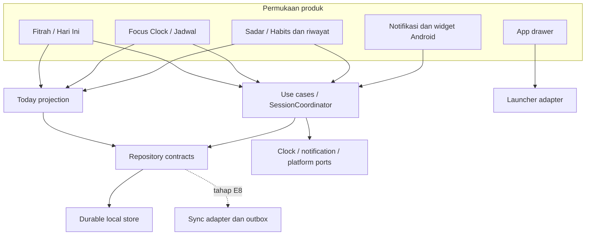
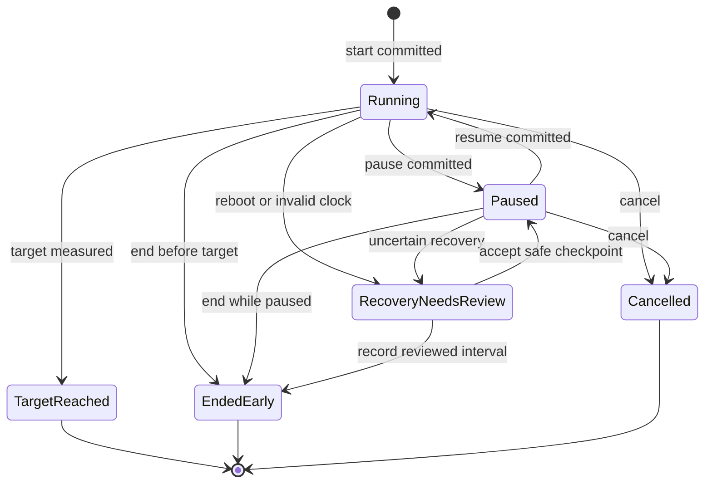

# Arsitektur Focus Clock ecosystem

## Paradigma dan pilihan distribusi

**Usulan:** modular monolith dalam satu aplikasi utama. UI Focus Clock, Sadar dan Fitrah memanggil use case yang sama, mengamati repository yang sama dan tidak menyimpan salinan domain sendiri. Adapter menangani OS, database dan koneksi eksternal. Ini memperbaiki jalur data di repo yang ada secara bertahap; bukan instruksi menulis ulang app.

| Pilihan | Batas yang harus ditanggung | Status usulan |
|---|---|---|
| Satu app, modul internal | Satu proses/data owner; koordinasi lintas fitur langsung | Pilihan awal |
| Tiga APK dengan IPC/ContentProvider | Owner data, proses mati, izin, signature, versi dan availability | Ditunda sampai alasan distribusinya jelas |
| Tiga APK dengan backend bersama | Akun, antrean offline, konflik, device authority | Jalur lanjutan setelah E8, jika masih dibutuhkan |
| Deep link saja | Navigasi dan payload per aksi; tidak menjamin replikasi data | Tidak memenuhi kontrak sinkronisasi |

Repository awal yang diusulkan: `/home/aizatfir/Project/Fitrah-Launcher`. Repo Sadar dan Focus Clock lama menjadi sumber referensi/import; fitur baru tidak disalin manual ke tiga repo. Keputusan ini belum memindahkan folder atau mengubah remote.



## Invariants dan aturan build

### AD-1 — Satu owner untuk tiap data

- **Binds:** FR-01–FR-14, semua UI.
- **Prevents:** Home dan grid/dial memperlihatkan habit/jadwal yang berbeda.
- **Rule:** GoalRepository, HabitRepository, ScheduleRepository, TaskRepository, NoteRepository dan SessionRepository menjadi logical owner tipe masing-masing. Implementasi boleh mengadaptasi repo existing; jangan membuat storage paralel per layar. UI hanya menyimpan state presentasi, misalnya tab, scroll, draft belum disimpan.

### AD-2 — Satu jalur mutasi sesi

- **Binds:** FR-03, FR-12–FR-15.
- **Prevents:** empat timer independen, sesi ter-overwrite, completion ganda.
- **Rule:** SessionCoordinator menangani start/pause/resume/end/recover. Semua entry termasuk notifikasi dan shortcut melewatinya. Maksimal satu sesi running/paused per ruang kerja lokal, ditegakkan transaksi durable. Start ketika ada sesi mengembalikan existing-session; tidak overwrite. Multi-tab web memerlukan single-writer coordination atau transaksi singleton yang ekuivalen, bukan guard Widget saja.

### AD-3 — Rencana, pengukuran dan tanda manual berbeda

- **Binds:** FR-07–FR-14, history.
- **Prevents:** waktu jadwal, target dan waktu yang dilakukan menjadi angka yang sama secara palsu.
- **Rule:** ScheduleBlock menyimpan planned time; FocusSession menyimpan actual seconds. HabitEntry menyimpan check-in manual, target snapshot dan proyeksi kontribusi sesi/manual log yang ber-ID. Target tercapai otomatis hanya mengikuti unit yang valid. Tanda manual “selesai” tidak menciptakan measured seconds. Akhir sesi awal menyimpan actual, tidak menyetarakan ke target.

### AD-4 — Waktu dan tanggal sesi

- **Binds:** FR-11, FR-13–FR-14.
- **Prevents:** drift saat sleep, resume mengganti tanggal mulai, kredit palsu saat jam berubah.
- **Rule:** Simpan immutable `sessionStartedAtUtc`, `attributionLocalDate`, `timeZoneId` dan offset saat start, terpisah dari awal running segment. Integer detik adalah unit accounting. Clock port menyediakan wall UTC dan monotonic interval plus boot identity pada Android. Dalam boot yang sama gunakan elapsed realtime, termasuk sleep; callback berkala hanya refresh tampilan/checkpoint. Setelah reboot atau anomali wall time, tandai recovery-needs-review; simpan checkpoint terakhir dan minta rekonsiliasi durasi yang belum pasti. Jangan mengarang measured time dari delta negatif/berlebihan. Sesi yang melintasi tengah malam tetap dikaitkan ke tanggal mulai; segment timestamp tetap tersedia untuk analisis lanjutan.

### AD-5 — Penyimpanan sukses berarti durable

- **Binds:** FR-09, FR-13, FR-20–FR-21.
- **Prevents:** UI memberi sukses lalu kehilangan data ketika restart.
- **Rule:** Command mengembalikan sukses setelah durable commit. Mode memory hanya untuk test/demo dengan label jelas. Kegagalan open/upgrade/write memberi typed error dan jalur retry/export/recovery; jangan seed ulang DB rusak. `isar = null` tidak boleh dianggap mode produksi normal. Browser yang tidak menyediakan storage menerima penjelasan keterbatasan, bukan klaim save.

### AD-6 — Akhir sesi atomik dan idempotent

- **Binds:** FR-07–FR-14, FR-20.
- **Prevents:** aktif sudah dihapus tetapi habit/history belum tercatat; duration masuk dua kali.
- **Rule:** Satu transaksi menulis terminal session, receipt operation, kontribusi berbasis session ID, dan clear active pointer. Daily aggregate diperbarui dalam transaksi yang sama atau dihitung dari ledger, tanpa menambah kontribusi duplikat. Notification/sync berada setelah commit; bila side effect gagal, retry tidak mengulang kredit. Jika adapter tidak mampu transaksi lintas tabel ini, adapter tidak lulus E1. Archive tidak menghapus ledger atau snapshot.

### AD-7 — Referensi dan schema lintas modul

- **Binds:** FR-01–FR-14, migrasi dan sync.
- **Prevents:** judul mirip dianggap entitas sama, integer lokal perangkat bertabrakan.
- **Rule:** Kontrak domain memakai stable string ID (UUID) untuk data baru; database legacy dapat tetap memiliki integer primary key dengan mapping persisten ber-key `(sourceStoreId, entityType, legacyKey)`. SourceStoreId dibuat sekali per instalasi sumber dan ikut backup; re-import memakai mapping yang sama. ID angka sama dari dua instalasi tidak dianggap entitas sama. `sourceRef` adalah salah satu habit, task atau free; `scheduleBlockId` opsional dan harus sesuai source jika keduanya ada. Goal linkage eksplisit/opsional; jangan parse dari description. Snapshot title/target/unit disimpan saat start. `operationId` unik, `revision` per aggregate, timestamp UTC, LocalDate `YYYY-MM-DD`, enum dengan nama stabil. Nama/schema/index ID Isar existing dibekukan sampai migrasi tervalidasi.

### AD-8 — Hubungan domain dan unit

- **Binds:** FR-05–FR-08, FR-12–FR-14.
- **Prevents:** ID habit lokal bertabrakan, timer menit dipakai sebagai reps, progression melompat dua kali.
- **Rule:** HabitDefinition terpisah dari occurrence harian; logical occurrence key unik `(habitId, localDate)`, termasuk ketika dimaterialisasi terlambat atau di dua perangkat. Simpan revisi target/schedule dengan effectiveFromLocalDate; gunakan revisi yang berlaku pada tanggal occurrence, bukan setting terbaru. TargetSnapshot terdiri dari type, unit, quantity dan revision; progression/hybrid juga snapshot langkah dan struktur set. Edit target default berlaku occurrence berikutnya yang belum dibekukan; koreksi occurrence existing adalah operasi eksplisit. Archive menghentikan occurrence baru sejak tanggal efektif yang dicatat, tanpa menghapus occurrence/bukti yang telah dibuat. Timed memakai duration contribution; count/binary memakai input sesuai unit. Progression advancement terikat occurrence ID dan operasi fulfilment yang idempotent. Timer kegiatan count dapat mencatat waktu opsional tanpa mengklaim rep selesai. Bila satu handler belum mendukung jenis existing, pertahankan data dan tampilkan status dukungan; jangan konversi otomatis.

### AD-9 — Today's state adalah proyeksi, bukan database keempat

- **Binds:** FR-03–FR-05, FR-08, FR-17.
- **Prevents:** cue AI acak, paused hilang, halaman historis mengganti status hari ini.
- **Rule:** TodaySnapshot dihitung dari tanggal lokal aktual, goals, durable TodaySelection, habit occurrences/entries, schedule dan active session yang sama. TodaySelection menyimpan localDate, sourceRef pilihan, optional scheduleBlockId, revision dan chosenAt; ini berbeda dari pinned Goal. Urutan cue deterministik sesuai FR-04; agenda selalu dibedakan dari actual session. Habit harian mencakup occurrence yang berlaku hari ini atau sudah mempunyai bukti hari ini; yang selesai/skip tetap terlihat dalam urutan user, tanpa auto-sort yang memindahkan target tap. Selected historical date adalah state layar tersendiri. Ganti hari/resume memperbarui tanggal aktual melalui Clock port; test memakai clock terkontrol. Proyeksi tidak menulis completion atau mengisi semua hari tanpa bukti sebagai gagal.

### AD-10 — Jadwal lintas siang dan malam

- **Binds:** FR-10–FR-11.
- **Prevents:** modulo 720 menghasilkan end=0, dua dial tidak sama, edit occurrence mengubah seri diam-diam.
- **Rule:** Kontrak baru menyimpan satu blok dengan local start/end date-time plus timeZoneId, end eksklusif dan durasi positif; tampilan 12/24 jam hanyalah proyeksi. Repo adapter legacy dapat memecah AM/PM/midnight dengan group ID dan mapping yang menjaga satu blok logis. Recurrence memakai series ID dan occurrence identity (series ID + local date), bukan dedup title/start. Edit satu occurrence membuat exception; edit “mulai hari ini dan seterusnya” membuat revision seri efektif, tidak mengubah occurrence historis. Hapus seri mempertahankan ledger/snapshot. Conflict check melihat seluruh blok logis. Waktu ambigu akibat zona/DST meminta pilihan atau offset eksplisit; event lama tidak bergeser karena timezone device berubah.

### AD-11 — Efek platform mengikuti capability sebenarnya

- **Binds:** FR-15–FR-18, FR-21.
- **Prevents:** fake app list/success, promise alarm/lockscreen yang OS tidak berikan.
- **Rule:** LauncherPort, ReminderPort dan PlatformCapabilities melaporkan available, denied, unsupported atau failed. App launch mengembalikan hasil yang UI periksa. OS permission/role dibaca ulang setelah kembali dari Settings. Session commit menyimpan desired reminder state ber-key sessionId/revision; adapter merekonsiliasi OS registration setelah commit, startup/resume, perubahan izin dan boot ketika OS mengizinkan. Crash sebelum OS registration dapat diperbaiki pada rekonsiliasi; callback lama memvalidasi sessionId/revision sebelum bertindak. Notifikasi completion memakai mekanisme OS yang sesuai izin; jangan bergantung proses Dart tetap hidup atau menjanjikan force-stop delivery. Widget/notification menampilkan snapshot domain; bukan owner timer. Lockscreen activity flags bukan implementasi widget lockscreen.

### AD-12 — Sinkronisasi tidak menjadi syarat lokal

- **Binds:** FR-20–FR-22.
- **Prevents:** app tidak bisa dipakai offline, deep link dianggap database bersama.
- **Rule:** Core tidak memerlukan login/network. E8 memakai SyncPort; operasi lokal commit bersama outbox, remote merge masuk melalui use case yang memvalidasi. Backend bukan sumber kebenaran timer yang menghitung detik setiap tick. Owner memilih Firebase dengan login opsional (25 Nov 2026); pemilihan ini belum mengaktifkan upload. Sync tetap mati sampai pengguna secara eksplisit memilih login dan mengaktifkan sync, dengan penjelasan data yang akan dikirim dan kontrol matikan/putus akun. Firebase Auth/Firestore code yang ada belum menjadi implementasi E8: perlu aturan akses Firestore, kontrak data, outbox, merge/recovery dan alur consent sebelum dipakai. Separate Android package dan web origin memiliki storage berbeda. Cross-app route hanya navigasi/command transport yang harus diverifikasi.

### AD-13 — Konflik lintas perangkat harus mempertahankan bukti

- **Binds:** FR-14, FR-20, FR-22.
- **Prevents:** edit offline menghapus histori atau dua timer mendapat kredit ganda diam-diam.
- **Rule:** Sesudah E8, session punya ownerDeviceId, monotonically increasing ownerEpoch dan revision. Handoff online memerlukan source checkpoint/release, lalu server compare-and-set ownerEpoch; requester tidak mengaku aktif sebelum ACK dan seluruh control command membawa epoch. Server menolak control command stale. Owner yang tidak tersedia tidak dapat dipindahkan diam-diam; user dapat menutup sesi pada safe checkpoint dan mulai sesi lokal baru. Offline tidak menjamin mutual exclusion global: dua perangkat bisa menghasilkan sesi independen atau catatan stale-owner. Merge mempertahankan catatan tersebut sebagai disputed/overlap untuk user, tanpa menambahnya ke kredit sesi yang sudah dimiliki epoch baru secara otomatis. Merge tidak menjumlah overlap sebagai waktu unik tanpa rekonsiliasi. HabitEntry konflik check-in memakai revision/base version dan pilihan user; session ledger dideduplikasi ID. Rename dapat memilih versi terbaru dengan backup; delete memakai tombstone, bukan menghapus bukti sesi.

### AD-14 — Data pribadi, backup dan upgrade

- **Binds:** FR-01, FR-08–FR-09, FR-20.
- **Prevents:** schema reset, label berubah mengubah masa lalu, ekspor rahasia API.
- **Rule:** Backup berisi formatVersion, sourceApp, exportedAtUtc, stable IDs dan checksum integritas; checksum bukan enkripsi. Jangan masukkan API keys, credentials atau OS tokens. User diberi tahu bahwa file ekspor mengandung data pribadi. Import memvalidasi ukuran, tipe, referensi, duplicate IDs dan versi sebelum commit, menampilkan preview, membuat backup lokal dan memakai transaksi. Versi lebih baru yang tidak didukung ditolak dengan data asli tetap ada. Migrasi diuji dengan fixture legacy dan rollback binary hanya dilakukan bila format data kompatibel.

### AD-15 — Reproducible build dan lingkungan

- **Binds:** semua rilis, FR-20–FR-22.
- **Prevents:** output Sadar mengganti Fitrah, app ID berubah, CI merusak generated schema.
- **Rule:** E0 merekam exact Flutter/Dart/JDK/Gradle/Android Gradle Plugin/Kotlin, min/compile/target SDK dan resolved dependencies yang benar-benar dipakai, entrypoint, applicationId, signing identity dan output per target. SDK toolchain dikunci untuk release, bukan string `3.x`. Native initial primary tetap package ID yang terinstal; jangan rename ID saat mengganti brand. Generated schema harus reproducible atau melewati langkah compatibility yang terdokumentasi/otomatis. Dev, preview dan prod tidak berbagi endpoint/credential tanpa keputusan. Bundle web dihasilkan ke output terpisah dan build metadata menyebut commit/entry; deploy bukan bagian otomatis dari build lokal.

### AD-16 — Integrasi tambahan tidak menguasai core

- **Binds:** FR-01–FR-22, AI/calendar masa depan.
- **Prevents:** API/service opsional menahan startup atau mengubah data tanpa bukti.
- **Rule:** AI, calendar dan prayer provider merupakan adapter opsional. Ketiadaannya tidak memblokir create habit/start session/save. Integrasi melakukan validasi dan memanggil command yang sama; tidak menulis DB/UI state sendiri. AI proposal menampilkan preview dan menerima keputusan user sebelum mengganti jadwal. Source/timezone/freshness pada prayer/calendar dapat diperiksa.

### AD-17 — Pendamping goal model-agnostic dan approval-first

- **Binds:** PRD FR-04a/04b, Goal, TodaySelection, Schedule, Habit dan Session contracts.
- **Rule:** Conversation menghasilkan `GoalUnderstanding` dan `PlanProposal`, bukan mutasi repository. Setiap proposal membawa input assumptions yang user dapat koreksi, konflik dengan komitmen existing, pilihan edit/terima/tolak, serta provider/model metadata seperlunya untuk troubleshooting. Hanya use case aplikasi yang memvalidasi dan menerapkan proposal sebagai satu batch durable setelah user menyetujui; AI tidak menentukan completion, memindahkan target lama diam-diam, atau mengklaim kemenangan. Adapter OpenAI-compatible/Gemini/provider lain implement kontrak yang sama; tool schema provider tidak menjadi domain contract. API key tetap di secure storage milik user atau server yang user pilih; log percakapan privat tidak dicatat tanpa opt-in. Kegagalan provider mempertahankan teks/draft lokal dan jalur manual.

## Seed kontrak bersama

Ini bentuk yang harus dipastikan E1/E2 sebelum modul dikerjakan terpisah; nama file implementasi dapat menyesuaikan pola repo. Model yang tidak dibutuhkan slice aktif tidak harus langsung ditambah.

| Aggregate | Isi yang menyatukan modul |
|---|---|
| Goal | id, title, optional why, cuePinned, archived, revision |
| TodaySelection | localDate, sourceRef, optional scheduleBlockId, chosenAtUtc, revision; pilihan tindakan, bukan Goal |
| Habit | id, optional goalId, title, actionHint, targetSpec, scheduleRule, archived, revision |
| HabitOccurrence | id, habitId, localDate, applicable targetSnapshot/stepSnapshot |
| HabitEntry | occurrenceId, manualStatus, manualQuantity, explicitlyLoggedSeconds, note, revision; measuredSeconds berasal ledger |
| Task | id, optional goalId, title, actionHint, completion, revision |
| ScheduleBlock | id, optional sourceRef, optional goalId, interval/timezone, series/occurrence identity, revision |
| FocusSession | id, sourceRef, optional scheduleBlockId/goalId, immutable startedAt/date/target snapshot, segments, actualSeconds, status, deviceId, revision |
| Note / Reflection | id, localDate, text, revision; terpisah dari Session ledger |
| LauncherPreferences | favorite/hidden/order, appearance, actual role/capability snapshot; bukan domain habits |

HabitEntry `manualStatus=yes` berarti laporan user; measuredSeconds tetap hanya total ledger. ExplicitlyLoggedSeconds berasal form “Tambahkan waktu yang belum tercatat” dengan operation ID dan total lama terlihat. Ringkasan membedakan keduanya. Koreksi sesi menggunakan adjustment tercatat; jangan mutate original duration tanpa jejak.

`manualQuantity` adalah nilai absolut per occurrence yang disimpan dengan expectedRevision, bukan increment yang boleh diulang. Input “tambah 5 reps” dikonversi use case menjadi revisi baru pada jalur mutasi terserialisasi. Durasi tambahan memakai identified log dengan operation ID, bukan menambahkan ulang nilai total. Contoh effective revision: occurrence 3 November sudah mempunyai target 45 menit; edit menjadi 60 menit pada hari itu secara default berlaku 4 November, dan occurrence 3 November tetap 45 menit. Mengubah target hari ini memerlukan aksi koreksi occurrence eksplisit, bukan efek samping edit definition.

**Fulfilment projection yang sama untuk seluruh layar:** cancelled tidak memberi kontribusi; ended-early dan target-reached memberi actual eligible seconds sekali per session ID. Jika user memilih manual yes/no/skip, tampilkan status laporan itu beserta bukti measured yang tetap utuh; clear manual status kembali ke perhitungan evidence. Tanpa override manual, timed fulfilled bila measured + explicitly logged duration mencapai snapshot target; positif di bawah target adalah partial. Count/binary/progression/hybrid mengikuti catatan unit/step/set, bukan duration umum. Denominator ringkasan menghitung occurrence eligible yang dibekukan pada tanggal tersebut, dengan skip/rest dilaporkan terpisah; hari yang belum dibuka tidak otomatis dianggap missed. Mengarsipkan definition tidak menghapus occurrence/bukti lama atau menulis ulang summary historis.

Browser/desktop Clock port memakai monotonic clock yang tersedia selama konteksnya hidup, wall checkpoint untuk reopen dan aturan uncertainty yang sama. Jika tab/boot identity tidak dapat dipastikan dan clock wall berubah, state recovery-needs-review berlaku; tidak ada klaim measured interval yang tidak dapat diverifikasi. Android same-boot monotonic capability tidak diasumsikan tersedia identik di browser.

### Command dan hasil

```text
StartSession(operationId, sourceRef, scheduleBlockId?, expectedSourceRevision)
PauseSession(operationId, sessionId, expectedRevision)
ResumeSession(operationId, sessionId, expectedRevision)
EndSession(operationId, sessionId, expectedRevision, reason)
RecordHabitEntry(operationId, occurrenceId, expectedRevision, manualInput)
SaveScheduleBlock(operationId, blockDraft, expectedRevision?)

Result = Success(value, revision)
       | ExistingSession(session)
       | Conflict(latestRevision, recoverableOptions)
       | ValidationError(field, reason)
       | PersistenceError(retryable, recoverableDraft)
       | CapabilityUnavailable(capability, recoveryAction)
```

Waktu efektif command berasal Clock port yang dipercaya pada app. Transport eksternal tidak boleh mengirim actualSeconds/habit completion tanpa validasi. Receipt idempotency menyimpan operationId, payload fingerprint dan hasil: lookup receipt dilakukan sebelum revision validation; replay payload sama mengembalikan hasil pertama meski revision sudah berubah. OperationId sama dengan payload berbeda ditolak. Rev check mencegah command pause/resume lama menimpa keadaan baru. Pengelola mengambil clock snapshot dan memvalidasi aggregate di dalam jalur mutasi terserialisasi.



Terminal session tetap tersimpan. Cancel tidak menambah kontribusi; riwayat menyimpan alasan/status dan durasi yang sudah terukur sebagai dibatalkan. TargetReached timed dapat menambah kontribusi, tetapi tidak mengaku rep/set progression selesai dari timer saja. Recovery review membedakan durasi terukur dan koreksi manual. Start memakai pemeriksaan active pointer yang sama pada seluruh jalur.

## Storage: keputusan E1 yang sengaja dibatasi

Baseline pada repo: Isar `3.1.0+1` dan Riverpod `^2.5.1` dengan resolved lockfile sebagai fakta kode, bukan rekomendasi versi terbaru. Source paket Isar tersebut tidak menyediakan open web yang berfungsi; lihat EVIDENCE. Jangan mengubah DB seluruh app hanya karena nama library lain populer.

| Kandidat | Pembuktian sebelum dipilih |
|---|---|
| Pertahankan native Isar + adapter browser durable | Same repository contract, transaksi completion, migrasi/backup, perbedaan semantics minimal |
| Unified storage yang mendukung native/browser | POC dengan data legacy terkonversi tanpa kehilangan identitas, dukungan offline/browser, biaya dependency/tooling |

E1 berjalan maksimal satu slice riset. Hasilnya ADR berisi kandidat, exact dependencies/toolchain, fixture hasil dan jalur migrasi. **Belum ada izin migrasi data dari dokumen ini.** Adapter yang dipilih wajib lulus atomic completion, reopen, offline, schema upgrade, backup/import dan ID precision. Bila unified candidate tidak lulus, scope awal tetap Android durable dan web hanya demo berlabel sampai adapter siap. E2 production storage mengikuti keputusan E1.

## Peta pemindahan bertahap

| Kode sekarang | Tujuan perubahan |
|---|---|
| `focus_clock_home_view.dart` local models/collections | Ganti read bindings per fitur menjadi repository projection; form draft tetap lokal |
| `_activeTimer`, QuickTimerHub, FocusSessionView | Jadikan adapter UI SessionCoordinator setelah equivalence gate E2 |
| `SadarTimerEngine` | Ambil logic/recovery yang berguna, perbaiki credit/date/transaction, gunakan satu owner baru atau refactor owner existing |
| `ActivityRepository` + `AnalogClockFace` | Pertahankan rendering/interaksi; adapter block identity/time menangani migrasi |
| `LoopHabitGridWidget` | Pertahankan akses history dan actions; ganti start callback ke coordinator dan unit-safe controls |
| Native `MainActivity.kt` | Pertahankan launch/icon capability; tambahkan hasil error/role/clock port sesuai kebutuhan slice |
| Multiple main files / deployment scripts | E0 menentukan yang didukung; jangan menghapus runner historical sebelum parity/import dibuktikan |

## Lingkungan, operasi dan kemampuan

Local dev memakai database/profile terpisah dari data harian bila membuat seed uji. Preview memakai test workspace dan config tersendiri. Production release mencantumkan versi format data, toolchain, commit dan capability. Cloud belum menjadi runtime dependency.

Log berisi session/operation ID, error code dan capability state; judul goal, refleksi dan credentials tidak ikut log default. Export diagnostik memerlukan aksi user. Keberhasilan release dinilai dari command/persistence/session evidence dan pemakaian pribadi, bukan log “success” dari MethodChannel saja.

| Permukaan | Kapabilitas yang direncanakan | Batas eksplisit |
|---|---|---|
| Android companion | Tujuan, habits, dial, sesi, history, backup | Tetap berguna tanpa default Home atau alarm permission |
| Android launcher | Daftar aplikasi aktual, favorit, role Home | Tidak mengklaim memblokir semua aplikasi/menampilkan widget lockscreen tanpa implementasi |
| Web | Domain yang sama dengan storage adapter durable | Tab suspend/ditutup membatasi alert; bukan launcher OS |
| Desktop | Domain yang sama; window/keyboard | Floating timer baru setelah fungsi core dan perbedaan capability dibuktikan |

## Deferred

- Provider cloud, auth dan conflict UI detail diputuskan sebelum E8, di bawah AD-12/AD-13. Jangan membangun sync per layar.
- Paket shared Dart diekstrak sesudah domain/sesi stabil dan ada consumer kedua. Pola modular sekarang tidak memerlukan monorepo tooling baru.
- App blocking memerlukan threat model, izin dan kemampuan Android tersendiri; bukan konsekuensi otomatis menjadi launcher.
- IoT, AI proaktif dan universal energy scoring tidak diperlukan oleh loop pertama.
- Skema indexing, batching sync, retention detail dan performa query mengikuti data nyata pada slice; hak kepemilikan, unit, identity dan transaksi di atas tetap mengikat.

## Referensi keputusan

Arsitektur ini mengambil prinsip source-of-truth dan repository dari [Flutter architecture](https://docs.flutter.dev/app-architecture/guide) serta [offline-first](https://docs.flutter.dev/app-architecture/design-patterns/offline-first). Batas app berasal dari [Android sandbox/storage](https://developer.android.com/privacy-and-security/security-best-practices), [ContentProvider](https://developer.android.com/guide/topics/providers/content-providers) dan [App Links](https://developer.android.com/training/app-links/about). Waktu interval mengacu [SystemClock](https://developer.android.com/reference/android/os/SystemClock), pengingat pada [alarms](https://developer.android.com/develop/background-work/services/alarms). Ini pilihan rancangan proyek, bukan nama class atau model yang diwajibkan dokumentasi tersebut.
