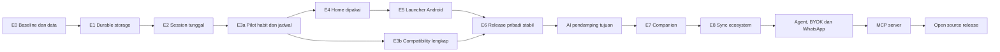

# Long build: dari keadaan sekarang sampai dipakai sehari-hari

Tanggal: 4 November 2026. Status: rencana kerja bertahap; milestone dan release tetap menunggu bukti gate masing-masing. Dependency dan gate lebih penting daripada nomor versi pemasaran. Detail task implementasi ditulis per slice setelah keputusan upstream disetujui, bukan membuat ribuan baris pseudocode untuk seluruh ekosistem sekarang.

## Jalur kerja

Perubahan UI exploratif/read-only boleh berjalan saat E1/E2 diselesaikan. Penggantian Home produksi menunggu data/sesi yang dipakai UI lulus. E5 dapat mulai memperbaiki launch failure/favorit setelah kontrak preferences E1 jelas; final launcher tetap melewati gate E4–E6.

## E0 — Baseline yang dapat dikembalikan

**Hasil:** satu sumber build, referensi UI dan inventaris data yang bisa diperiksa. Tidak mengubah model produk atau membuang data. Status masih parsial karena perangkat dan backup data belum tersedia.

**Lokasi yang ditinjau:** `lib/main.dart`, `main_fitrah.dart`, `main_sadar.dart`, `package.json`, `vercel.json`, `.github/workflows/`, `pubspec.lock`, `lib/models/*.g.dart`, manifest Android dan signing config. Referensi visual dial dari OWNER-INTENT.

- [ ] Rekam Git status, commit, toolchain Flutter/Dart/JDK/Gradle/AGP/Kotlin, min/compile/target SDK, resolved dependencies dan APK yang dipakai Fahim. Pisahkan dirty build artifacts dari source; jangan reset pekerjaan yang sudah ada.
- [ ] Pilih entrypoint Android utama dan feature flags yang benar-benar didukung. Tentukan directory output untuk Fitrah, Focus dan Sadar sehingga build berikutnya tidak menimpa deployment lain.
- [ ] Inventaris state per layar, data DB, secure preferences, volatile collections dan timer owners. Beri label implemented/source-only, verified-runtime, broken atau historical.
- [ ] Rekam nama/ID schema/index Isar existing dan prosedur generator; bandingkan clean generation dalam checkout sementara dengan schema yang dipakai release. Gagal bila generation mengubah identitas DB secara tak terencana.
- [ ] Ambil backup yang konsisten dari instalasi existing sebelum upgrade; tetapkan fixture tersanitasi untuk migration check. Data volatile yang sudah hilang tidak boleh disebut bisa dipulihkan dari DB.
- [ ] Rekam perangkat, OS, font scale, resolusi, dataset realistis dan screenshot dial yang disepakati sebagai baseline.

**Gate:** clean checkout dengan toolchain yang dicatat menghasilkan artifact dengan entrypoint/identity yang benar. Data backup dapat dibaca; fixture memuat setidaknya habit timed/count/binary/progression/hybrid, jadwal recurring dan sesi paused. Screenshot baseline terbuka untuk review. Tidak ada klaim “semua fitur selesai” dari build berhasil saja.

**Rollback:** baseline source/binary tersimpan. Upgrade data belum dilakukan, sehingga revert UI/source tidak membutuhkan downgrade schema.

## E1 — Penyimpanan yang tidak berbohong

**Hasil:** keputusan storage dan jalur read/write yang durable dengan kontrak serta recovery yang sama di semua modul core.

**Lokasi:** `lib/data/isar_service.dart`, repository existing, `providers/`, launcher settings, model IDs, bootstrap main. File kontrak/adapters baru hanya sebanyak yang perlu untuk mengganti jalur yang sedang disentuh.

- [ ] Tetapkan UUID mapping untuk entitas legacy, LocalDate/timezone dan TargetSnapshot sesuai ARCHITECTURE. Nama koleksi Isar existing dipertahankan; migration proof lintas perangkat masih terbuka.
- [x] Spike native storage: Isar Community 3.4.1 dipakai pada Android setelah Isar 3.1 binary menampilkan peringatan alignment 16 KB. Browser adapter versus satu storage lintas platform belum dipilih; lihat [ADR E1](decisions/ADR-E1-storage.md).
- [ ] Definisikan Result/error contracts dan command success sesudah commit. Ganti silent memory fallback produksi dengan recovery state serta retry; test/demo tetap eksplisit.
- [ ] Definisikan export versioned dan import preview/validation. Uji referential integrity, duplicate IDs, versi lebih baru, file rusak, disk penuh/write failure.
- [ ] Buat migrasi awal yang non-destruktif dari data existing dan save draft yang dapat dipulihkan. Jangan memindahkan tiga app private DB seolah lokasinya satu.

**Slice selesai:** bootstrap storage yang gagal sekarang membuka layar pemulihan dengan retry pada ketiga entry point, tanpa fallback memory pada production. Instalasi native lama berhasil di-upgrade ke Isar Community 3.4.1 di emulator yang sama; database settings lama terbuka tanpa error Isar. APK telah dibangun untuk Android 16 KB dan alignment setiap LOAD segment `libisar.so` x86_64 adalah 0x4000. Backup user, device riil, dan persistensi web belum diverifikasi; E0/E1 tetap terbuka.

**Gate:** close/reopen benar-benar mempertahankan perubahan pada Android. Adapter web, jika dipilih, lulus reload/offline dan transaksi completion; jika belum lulus, web tetap demo berlabel, bukan produk persisten. Round-trip backup mempertahankan ID/count/status/duration. Injected failure tidak menampilkan Tersimpan. Lulus check ini sebelum E2/E3 schema produk diperluas.

**Catatan riset awal (4 Nov 2026):** Dokumentasi Isar menjelaskan operasi write memakai transaksi dan migrasi perubahan data perlu ditulis sendiri; perubahan skema otomatis tidak membuktikan transformasi data produk ([transactions](https://isar.dev/transactions.html), [data migration](https://isar.dev/recipes/data_migration.html)). Drift WASM di web memerlukan aset SQLite WASM dan worker yang versinya cocok, header MIME yang benar, serta storage probe; OPFS mode memakai COOP/COEP dan punya fallback berbeda termasuk in-memory ([Drift web](https://drift.simonbinder.eu/platforms/web/)).

**Temuan/fix native schema dan Android (4 Nov 2026):** Isolated Linux host test reproduced `IllegalArg: Collection id is invalid` at `Isar.open`. Committed generated IDs did not match the XXH3 hash of unchanged collection names; history shows bounded IDs were introduced for Dart-to-JS compatibility. Generated exact hashes are kept JavaScript-safe by `tool/fix_isar_schema_ids.dart`; after code generation, run that transformer. `test/isar_service_persistence_test.dart` opens the full store, confirms only AppSettings is seeded, inserts an Activity, closes/reopens, and reads the same ID/title/date. Native persistence passes on Linux. Isar 3.1's Android x86_64 binary raised a 16 KB compatibility dialog; the app was upgraded in place to `isar_community` / `_flutter_libs` 3.4.1. Existing settings DB opened after upgrade, the warning disappeared, and `readelf` verified arm64 `libisar.so` LOAD alignment at 0x4000. Latest unified launcher arm64 debug APK `build/app/outputs/flutter-apk/app-arm64-v8a-debug.apk` SHA-256 `40003ccd1b4b5f50ed09eb97109ca8d65e4488838973e267f3a9654776610a94` (118 MiB). Build dependency file confirms it includes `sadar_timer_view.dart`; the Flutter kernel timestamp is newer than the source. `flutter build web --no-pub --no-wasm-dry-run --output=/tmp/focus-clock-web-unified --release` compiles the standard JS target; Wasm is not supported. Community Isar's web implementation still throws UnsupportedError and app startup reaches storage recovery, so web compile is not web persistence. `flutter analyze --no-pub` is clean and all 85 tests pass, including Home habit Play opening the shared Sadar timer. No Android device is currently attached for install verification. E1 remains open for browser persistence, backup/export recovery and physical-device verification.

**Keputusan yang diblokir sampai gate:** pilihan database produksi, schema migration detail dan tanggal release web. Jangan menulis adapter lain berdasarkan dugaan masing-masing.

## E2 — Satu sesi fokus yang dapat dipercaya

**Hasil:** dari semua titik masuk, user mendapat satu state sesi dan catatan actual duration yang sama.

**Lokasi:** `services/sadar_timer_engine.dart`, `models/timer_session.dart`, `providers/providers.dart` quick timer fields, `widgets/quick_timer_hub.dart`, `features/focusclock/widgets/focus_session_view.dart`, `features/sadar/widgets/sadar_timer_view.dart`, `features/sadar/widgets/sadar_ypt_focus_view.dart`, `features/launcher/widgets/focus_clock_home_view.dart`, `sadar_repository.dart`, native clock/reminder bridge.

- [ ] Pisahkan lifecycle record, running segment/checkpoint dan immutable attribution date. Tambahkan clock port terkontrol untuk unit checks; Android monotonic interval/same-boot recovery harus nyata, bukan asumsi semua DateTime delta aman.
- [ ] Ubah engine existing menjadi satu SessionCoordinator atau adapter menuju satu owner baru. Jangan mempertahankan dua owner aktif selama rollout; gunakan satu feature switch untuk consumer yang sudah dialihkan.
- [ ] Implement start/pause/resume/end/recover dengan operation receipts, revisions dan transaction single-active pointer. Pasang guard ketika startup restore masih berjalan.
- [ ] Simpan ledger sesi dan kontribusi atomik, lalu side effects notifikasi. Finish early mencatat actual, tanpa menaikkan ke target/minimum 15 menit.
- [ ] Alihkan satu jalur habit Play sampai selesai sebagai vertical slice. Setelah lulus, alihkan Home, QuickTimerHub, dial/fullscreen dan notification actions ke owner yang sama. Hapus duplicate countdown owner sesudah parity, pertahankan UI terpilih.
- [ ] Jadwalkan pengingat OS sesuai izin. Verifikasi cancel/pause/resume membatalkan alarm lama dan stale action tidak mengubah sesi baru.
- [ ] Persist desired reminder state bersama session commit dan rekonsiliasi saat startup/resume/perubahan izin/boot yang diizinkan. Inject crash sebelum OS registration untuk membuktikan retry tidak menggandakan atau kehilangan reminder.

**Checks bermakna:** start ganda; start sesi lain saat running/paused; pause/resume berulang; finish 8 menit dari target 45; dua sesi habit yang sama; crash di antara commit dan side effect; storage error; background/sleep; process death; tengah malam; change clock/timezone; reboot; stale notification. Terpisahkan test deterministic state machine dari device/OS checks.

**Gate:** satu status terlihat di seluruh entry points, ledger tidak dobel, sesi survive reopen, penghentian awal tidak mengklaim 45 menit. Reboot/clock uncertainty meminta review. Notifikasi bukan syarat penyimpanan sesi.

**Slice interim:** Play pada habit grid Home, Sadar habit grid dan quick action membuka `SadarTimerView` memakai `SadarTimerEngine`. Home free/preset dan scheduled Activity timers, `QuickTimerHub`, command palette, voice-created Activity timers, FocusSessionView, dan YPT kini memakai engine yang sama. `TimerSession` menambah source kind nullable, Activity ID dan running-segment checkpoint; row lama tanpa source kind dipulihkan sebagai habit. YPT menggunakan source kind tersendiri yang ditambahkan di akhir enum agar index yang tersimpan tetap stabil. Target YPT beralih ke waktu ekstra tanpa menutup sesi atau mencatat terlalu dini; sesi overtime pulih tetap berjalan setelah app dibuka ulang, dan tombol selesai menyimpan actual duration melalui transaksi timer habit yang sama. Guard foreground app, immersive screen dan emergency hold tetap ada; emergency exit menghapus sesi yang aktif setelah penyimpanan berhasil. QuickTimerHub membuat Activity saat mulai; pause/resume menunggu commit; durasi tambah dipersistenkan; Activity completion menyimpan actual seconds dan memperbarui Activity ID yang tepat dalam transaksi bersama penghapusan sesi. FocusSessionView memulai Activity ID yang tepat, memakai state pause/resume/actual dari engine, dan menampilkan retry bila completion belum tersimpan. Test state machine, Home, QuickTimerHub, FocusSessionView, YPT, repository dan Isar reopen/transaction lulus; analyzer bersih. Full suite terbaru: 105 tests pass.

E2 tetap terbuka: semua consumer timer yang saat ini ada memakai owner yang sama, tetapi clock monotonic/same-boot, immutable attribution date, operation receipts/revisions, session ledger/history, notification reconciliation, device recovery UI, reboot/process-death uncertainty dan physical Android checks belum diverifikasi. Home preset completion membuat Activity row(s) dan menghapus TimerSession dalam transaksi Isar yang sama; failure injection membuktikan sesi tetap aktif sampai retry sukses dan retry tidak menggandakan Activity. Jangan anggap satu owner saja menutup gate E2.

## E3 — Habit, tindakan, jadwal dan tujuan tersambung

**Hasil:** user dapat memilih habit atau task yang sama dari Home, grid dan dial, menjalankannya, lalu melihat bukti yang sama.

**Lokasi:** model Goal baru bila E1 memutuskan format, `habit.dart`, `habit_entry.dart`, `task.dart`, `activity.dart`/Schedule adapter, Sadar/Activity/Task repositories, `loop_habit_grid_widget.dart`, Home local `HabitModel`/`BlockItem`/`PresetItem`, notes/inbox persistence.

**Bagi menjadi E3a dan E3b.** E3a menyelesaikan satu loop timed/binary end-to-end, Goal/TodaySelection, satu jadwal logis, backup dan read-only preservation seluruh legacy data. Itu pilot U0 pertama: Fahim dapat membuka dan memakai satu kegiatan nyata sebelum semua editor lengkap. E3b menyelesaikan progression/hybrid/count, recurrence editing, inbox/note/reflection dan migrasi compatibility yang tersisa. E4 boleh berjalan setelah E3a; E6 menunggu E3b. Jenis yang belum didukung pada pilot mempunyai status jelas dan akses baca/ekspor, tanpa tombol yang berpura-pura bekerja.

- [ ] Implement Goal optional links, pinned cue dan durable TodaySelection per tanggal tanpa wizard wajib. Import `focusGoal` legacy melalui versioned mapping `(sourceStoreId, entityType, legacyKey)` bila datanya tersedia; jangan menebak link dari description/title. Re-import fixture yang sama harus idempotent, angka ID sama dari instalasi berbeda tetap berbeda.
- [ ] Tetapkan occurrence/series identity, target snapshots, habit recurrence dan archive behavior. Migrasi status history tanpa menggantinya dengan target hari ini.
- [ ] Selesaikan binary/count/timed path; progression/hybrid mempertahankan step/unit/rest dan menghindari duplicate advancement. Jangan tampilkan Play pada handler yang belum mendukung jenisnya.
- [ ] Ganti local collections Home satu per satu dengan live repository bindings. Jadwal menunggu commit sebelum UI sukses; ID local dan DB tidak dibangkitkan terpisah.
- [ ] Satu ScheduleBlock logis punya adapter 12/24h, midnight dan recurring editing yang benar. Reuse dial/time_math; jangan mengganti renderer untuk memperbaiki model waktu.
- [ ] Persist Task inbox, Note dan Reflection. Jadwalkan existing Task dengan ID asli; pindah/unschedule tidak membuat duplikasi.
- [ ] Today's projection membaca tanggal aktual, session, pin user, agenda dan occurrences. Buka tanggal historis tanpa memengaruhi status Hari Ini.

**Gate:** Goal → habit LKS → jadwalkan → start → 8 menit → end → history terukur. Binary done tidak menghasilkan menit palsu. Progression double tap hanya maju satu occurrence. Dua jadwal dengan judul sama tetap punya identitas berbeda. Mengubah target/arsip hari ini tidak menulis ulang riwayat kemarin.

## E4 — Home yang enak dibaca dan dioperasikan

**Hasil:** rancangan Home yang disetujui pemilik memakai data sungguhan. Habits, dial dan tujuan mendapat hierarki yang jelas.

**Lokasi:** `fitrah_launcher_shell.dart`, Home widget, `loop_habit_grid_widget.dart`, `core/theme.dart`, NowNext/session summary dan editor terkait. Extract widget sesuai tanggung jawab yang sedang disentuh; jangan melakukan refactor semua app sekaligus.

- [x] Review [mockup](mockups/today.html) sebagai hierarki. Pemilik menyetujui susunannya dengan arahan mempertahankan palette, bookpaper dan clock face Focus Clock yang sudah dipilih.
- [x] Tambahkan cue tujuan editable ke Home dan simpan dalam LauncherSettings lokal; kegagalan simpan ditampilkan dan nilai sebelumnya dipulihkan. Pilihan `full_book` tetap memakai dial Warm Journal yang sudah ada.
- [ ] Capture Flutter dengan dataset sama dan review goal/dial/habit placement sebelum implementasi menyebar.
- [ ] Terapkan semantic tokens, font bundled/platform, TextScaler dan single primary action per konteks. Hapus rail tools duplikat dari hero; taruh aksi di konteksnya.
- [ ] Home memakai reusable habit row yang membaca progress measured/manual dan aksi unit-safe. Destination Habits memuat detail/history; Home tetap dapat start/check-in.
- [ ] Sediakan visible navigation, Back yang konsisten, inbox capture singkat, settings satu jalur dan session summary lintas destination.
- [ ] Kerjakan state empty, loading, busy, failed, restored, paused, target reached dan uncertain recovery. Jangan menunda ini sesudah screenshot happy path.
- [ ] Uji glance dengan Fahim, long titles, banyak habits, font 200%, lebar 320 dp, landscape, keyboard dan TalkBack. Dial punya daftar setara.

**Gate:** Fahim menemukan tujuan/status/aksi tanpa bantuan penjelasan builder; memulai habitual focus tidak membutuhkan settings. Tidak ada overflow/aksi tertutup/gesture-only workflow pada kondisi yang disepakati. screenshot sebelum/sesudah dan feedback dicatat. Gate visual tidak mengklaim persistence tanpa bukti E1–E3.

**Slice interim — honest Hari Ini data (4 Nov 2026):** Isar no longer inserts generic presets or habits; AppSettings initialization remains. Production Home starts without an assumed identity or sleep blocks, and the agenda carousel, dial, chronological list and current schedule label consume the same `activitiesByDateProvider` projection. Empty, loading and error states have explicit copy; `useSampleData` builds preview Activity objects in memory only. Home create/check-complete/delete paths use `ActivityRepository` outside preview; conflict checks use persisted rows; timer completion commits the same Activity and prevents duplicate finish writes. Home's persisted habit Play now opens the durable Sadar session screen. Full suite: 85 tests passing; `flutter analyze --no-pub`, Android arm64 debug build and web JS compile pass. Latest arm64 APK: `build/app/outputs/flutter-apk/app-arm64-v8a-debug.apk`, SHA-256 `40003ccd1b4b5f50ed09eb97109ca8d65e4488838973e267f3a9654776610a94`. Device install verification, browser storage, backup recovery, reboot/upgrade behavior and full E4 glance checks remain open. E0/E1/E2 and E4 gates remain open.

## E5 — Fitrah menjadi launcher yang dapat dipakai

**Hasil:** user dapat menjadikan Fitrah default Home tanpa kehilangan akses aplikasi atau konteks sesi.

**Lokasi:** `minimalist_app_drawer.dart`, `app_launcher_service.dart`, launcher preferences/settings, `MainActivity.kt`, Android manifests/styles dan lifecycle shell.

- [ ] App list Android asli, refresh ketika app ditambah/dihapus atau launcher resume, label serta icon yang benar. Listing failure menghasilkan error/retry, bukan daftar simulasi.
- [ ] Tunggu dan periksa launch result; tampilkan not-installed/unavailable/error yang tepat. App info/uninstall memakai UI sistem; kembali ke app refresh availability.
- [ ] Persist favorites/hidden/order. Jangan mengandalkan package dialer/camera tertentu ada pada semua vendor; intent berbasis capability dengan hasil yang dilaporkan.
- [ ] Search/clear/Back bekerja, keyboard tidak menutup hasil terakhir. Scrubber melompat ke kelompok aktual, bukan estimasi offset 130+index×56 yang salah ketika header/teks berubah.
- [ ] Request/verifikasi default Home role. Audit manifest utama dan manifest `src/fitrah` yang masih menyebut activity lama; hanya source set/flavor yang benar-benar dikonfigurasi masuk artifact.
- [ ] Pastikan Home intent dan unlock biasa tidak membuka fullscreen timer/lockscreen overlay tanpa permintaan user. Wallpaper terang/gelap memiliki keterbacaan memadai.
- [ ] Pisahkan permission yang benar-benar diperlukan dari fitur opsional; app listing/launch tidak memerlukan app-blocking feature hanya karena manifest memuat permission-nya.

**Gate:** default Home pada perangkat harian, reboot, buka app, search, launch, app info, install/uninstall dan kembali Home semuanya dapat diselesaikan. Jika suatu vendor menolak capability, launcher menunjukkan recovery. Sesi yang aktif tetap sama.

## E6 — Rilis pribadi stabil

**Hasil:** Fahim bisa menggunakan build harian dan upgrade dengan data utuh.

- [ ] Buat release/profile build dengan signing identity yang bisa meng-upgrade instalasi acuan. Putuskan public signing terpisah; jangan mengganti key/app ID diam-diam.
- [ ] Verifikasi offline core, restart, reboot, denial notifikasi/alarm, storage failure, battery restrictions, dan font/warna/ukuran layar. Force stop dicatat sebagai OS boundary, bukan kegagalan timer yang bisa dijanjikan hilang.
- [ ] Ukur startup/resume/frame behavior dengan perangkat/dataset E0; tick timer tidak rebuild seluruh Home/grid. Tindaklanjuti bottleneck yang diukur.
- [ ] Jalankan fixture migrasi dan export/import round-trip. Rehearse recovery pada salinan data, jangan eksperimen dengan satu-satunya DB harian.
- [ ] Fahim memakai app minimal tujuh hari dengan goals/habits miliknya. Catat setiap aksi mati, keadaan salah, kehilangan data dan kebutuhan menyiasati app.
- [ ] Perbaiki data loss, durasi salah, crash, launcher exit/unusable dan aksesibilitas blocking sebelum menambah fitur baru. Update README/capability matrix dengan bukti rilis aktual.

**Gate:** tidak ada isu data loss/credit salah/core dead action yang terbuka. Loop UJ-1–UJ-6 dapat dilakukan tanpa langkah workaround. Riwayat dan session records dari penggunaan nyata tetap dapat dibaca sesudah upgrade. Ini baru definisi “enak dipakai” rilis pribadi; public rollout memerlukan gate distribusi sendiri.

## E6a — Pendamping tujuan dan perencana

**Hasil:** user dapat bercerita atau menyebut tujuan, melihat rangkuman yang dapat dikoreksi, menerima draft langkah/jadwal yang realistis, lalu memilih sendiri apakah akan menerapkannya. Contoh acuan: “Aku ingin menang LKS nasional IT Software Solution, tapi sekolah dan tugas lain juga banyak.”

**Prasyarat:** E1 persistence, E2 session ownership, dan E3 Goal/Habit/Schedule contracts harus memiliki jalur mutasi durable. AI tidak boleh memutasi Home-local shadow state atau menandai kegiatan selesai.

- [ ] Gunakan `AiService`/BYOK yang ada sebagai referensi implementasi, bukan kontrak produk; adapter provider mengeluarkan `GoalUnderstanding` dan `PlanProposal` model-independent.
- [ ] Percakapan dimulai dari input bebas atau “Apa tujuanmu?”; klarifikasi tenggat, kemampuan sekarang, komitmen tetap, ruang harian dan istirahat hanya bila datanya mengubah proposal.
- [ ] Proposal menyebut assumptions, waktu fleksibel, konflik dengan jadwal, dan alasan ringkas; edit/terima/tolak seluruhnya terlihat sebelum commit.
- [ ] Apply proposal lewat use case domain yang sama dengan editor manual, validasi lalu commit atomik/idempotent. AI tidak mengubah bukti habit/session dan tidak menjanjikan hasil lomba.
- [ ] BYOK disimpan pada secure storage yang ada, provider bisa ditukar, dan error/invalid output kembali ke draft serta jalur manual. Core offline tetap bekerja tanpa API.
- [ ] Tidak ada pengiriman percakapan ke provider tanpa aksi user yang jelas; UI menampilkan provider/model yang dipakai dan tidak mencatat prompt privat diam-diam.

**Gate:** cerita → tujuan terkoreksi → draft → edit → setujui → Home cue → satu aktivitas mulai → actual session/history tetap benar. Provider timeout, malformed output dan user menolak proposal tidak mengubah jadwal existing. Jalur tanpa AI tetap dapat menyelesaikan seluruh alur manual.

## E7 — Web dan desktop companion

**Hasil:** user dapat memakai domain yang sama di laptop/browser, dengan batas kemampuan yang jujur.

- [ ] Consumer kedua memakai shared domain/contracts yang sama; ekstrak Dart package bila duplikasi nyata memerlukannya. Jangan copy/paste service baru ke repo Sadar.
- [ ] Adapter storage browser dari E1 dibuktikan reload, offline setelah initial cache, storage unavailable, eviction/export recovery dan multi-tab single-writer. Browser yang menghapus local storage tetap dapat menyebabkan kehilangan data yang belum dibackup; jangan menyebutnya cloud backup.
- [ ] Build target/output/entry point untuk Focus/Sadar/Fitrah terpisah; screenshot dan build metadata membuktikan halaman tujuan. Tidak deploy stale precompiled bundle dari root/`public/` tanpa source build.
- [ ] Capability Android-only tidak disimulasikan sukses. Web session state dapat pulih ketika tab dibuka lagi; alarm saat tab ditutup tidak dijanjikan setara Android.
- [ ] Desktop keyboard/resizable window bekerja. Floating timer ditambahkan hanya bila core session owner yang sama dapat mengendalikannya.

**Gate:** goals/habits/schedule/session tersimpan di setiap target yang dinyatakan didukung; data di perangkat ini diberi label sampai E8. Preview dapat direview sebelum produksi. Pemisahan web views bukan data sync.

## E8 — Ekosistem lintas perangkat dan opsi app terpisah

**Hasil:** bila user menginginkannya, HP dan companion berbagi data dengan batas offline/konflik yang dapat dipahami.

- [ ] Fahim memilih skenario riil (contoh: mulai sesi HP, lanjut laptop, lihat habit dari keduanya). Tentukan kebutuhan akun, biaya dan provider sebelum mengaktifkan Firebase/Supabase/layanan lain. Bukti library existing tidak sama dengan keputusan produk.
- [ ] Bangun adapter sync dengan auth per user, outbox lokal, operation ID, retries, cursor/ack, tombstones, contract version dan log yang tidak memuat isi pribadi. Test unauthorized access pada data lain.
- [ ] Implement online handoff dengan expected revision/ownership ACK. Offline tetap lokal; overlap sessions dipertahankan untuk review, tidak diringkas ganda sebagai jam unik.
- [ ] Gunakan owner epoch fencing, source checkpoint/release dan server CAS. Stale-owner control ditolak; offline evidence tetap disimpan disputed untuk rekonsiliasi. Jangan mengklaim handoff selesai jika perangkat sumber tidak mengakui pelepasan sesi.
- [ ] Uji dua perangkat edit habit offline, rename/archive conflict, replay operation, jaringan putus di tengah ACK, server reset/retry, zone/date berbeda dan sesi overlap.
- [ ] Bila tiga app terpisah masih bermanfaat, pilih data owner/IPC atau backend sebagai ADR distribusi. APK terpisah tidak mengakses private DB satu sama lain secara otomatis. Deep link dibatasi routing dan request tervalidasi.

**Gate:** actual cross-device round-trip dibuktikan pada perangkat nyata, konflik tidak menghapus bukti, log/indikator membedakan local pending dan synced. Login/network tetap bukan syarat core offline. Rilis tiga APK baru menunggu gate ini, bukan dikerjakan paralel dengan pemulihan Android pertama.

## E9 — AI agent, API milik user dan WhatsApp

**Hasil:** user dapat memilih model/provider dengan API key miliknya, mengobrol tentang arah dan tindakan yang berulang, lalu meminta agent menyiapkan perubahan jadwal melalui command domain yang telah disetujui. WhatsApp menjadi kanal opsional yang meminta otorisasi eksplisit.

- [ ] Pertahankan BYOK secure storage; definisikan provider adapter umum, dukungan endpoint/model yang diuji, validasi key, delete/replace, biaya/consent info, serta fallback manual.
- [ ] Pisahkan chat/understanding dari tool actions. Perintah baca dan proposal memiliki batas data; write/action memerlukan preview dan approval untuk setiap perubahan penting. Jangan mengirim Goal, refleksi, lokasi, atau habit tanpa persetujuan yang jelas.
- [ ] Pakai user-selected goal, nilai berulang, tanggung jawab wajib, energi yang user laporkan, waktu nyata dan istirahat sebagai konteks proposal; agent tidak menilai iman/karakter, menjamin lomba, atau memaksa jadwal ekstrem.
- [ ] Implement WhatsApp hanya dengan WhatsApp-supported auth/API/transport setelah verifikasi produk dan biaya; jangan menyimpan session token di chat, membypass encryption, atau menjadikan bot syarat core.
- [ ] Sediakan pause/revoke/delete connection, least-privilege scopes, rate limits, privacy-safe audit receipts dan cara koreksi aksi.

**Gate:** satu provider berhasil, tidak valid, timeout dan limit tercapai dengan keadaan data yang jujur; user dapat ganti key/provider, putus koneksi dan kembali kerja manual. Tool-write tidak berjalan tanpa approval. WhatsApp pesan salah tujuan, token invalid dan revoke tidak bocorkan data atau mengulang aksi.

## E10 — MCP untuk koneksi lintas tools

**Hasil:** client MCP yang dipilih user dapat membaca/menjalankan kemampuan Focus Clock dalam scope yang ia izinkan.

- [ ] Tetapkan resource/read tools dan action tools terpisah, schemas versioned, identifier stabil, permission scopes, pagination, timezone, error semantics, idempotency dan consent transport.
- [ ] Host/server melakukan auth per user dan validasi policy; API key tidak menjadi alasan untuk mengeluarkan seluruh database atau credential provider.
- [ ] Action schedule/session memakai use case domain yang sama dan approval/receipts yang sama seperti app; tool client tidak dapat menyatakan habit selesai dari prompt.
- [ ] Revoke akses mencabut token aktif; logs tidak menyimpan prompt/teks habit kecuali user memilih opt-in. Uji unauthorized read/write, replay, stale revision dan malformed payload.

**Gate:** client independen berhasil discover/read sesuai scope, melakukan proposal yang user setujui, serta menerima penolakan/konflik/revoke tanpa side effect ekstra. Core app tetap tersedia tanpa MCP server.

## E11 — Open-source dan distribusi publik

**Hasil:** source dan artefak publik dapat diambil, dibangun ulang dan dirilis tanpa membawa credential/signing key atau menyebut lisensi yang tidak ada.

- [ ] Audit dependency/license/assets dan notices; pilih lisensi dengan pemilik, tambah `LICENSE`, privacy/security/contribution guidance dan update README hanya dengan kapabilitas yang benar.
- [ ] Pindahkan credential dari tracked config jika ada secret; audit Firebase rules/client restrictions, logs, data samples, generated outputs, embedded preferences dan key storage.
- [ ] Siapkan CI reproducible dengan Flutter/Dart/JDK/SDK versi terkunci, entry point/output matrix yang benar, Linux `libsecret-1-dev`, release signing dari secret, dan checksums.
- [ ] Publikasikan Android/desktop/web hanya jika masing-masing feature/capability lulus; GitHub Release berisi artifact yang konsisten dengan tag dan manifest build. Tag tidak otomatis deploy ke Vercel/production.
- [ ] Pertahankan signing identity pribadi agar APK bisa upgrade; kunci publik release dan private release dipisahkan/ditetapkan jelas sebelum upload. Jangan menimpa artifact/link yang pemilik gunakan tanpa catatan migrasi.

**Gate:** license dan notices valid, clean CI matrix lulus dari checkout bersih, asset checksums cocok, APK publik dapat dipasang/upgrade dengan key yang diumumkan, dan halaman Release memberi file yang benar-benar tersedia. Jika salah satu target belum siap, tandai unsupported alih-alih mempublikasikan klaim palsu.

## Cara builder menerima dan menyerahkan slice

Sebelum coding, tulis satu task kecil berisi requirement ID, file yang disentuh, kontrak yang dikonsumsi, perubahan data, contoh gagal yang akan dibuktikan dan syarat stop. Review kebutuhan visual terhadap DESIGN/EXPERIENCE. Simpan checkpoint source dan backup sebelum migrasi.

Selesai slice ketika behavior dan failure path yang relevan diperiksa. Handoff menyebut perubahan, command/check yang dijalankan, hasil, screenshot bila UI berubah, dan batas yang belum diverifikasi. Source-only audit bukan runtime pass. Jangan menambah dependency, route atau tabel untuk kebutuhan yang belum punya slice.

Rencana ini tidak menetapkan jumlah hari kerja palsu. E0 mengukur kapasitas dan toolchain; sesudahnya pecah milestone aktif menjadi satu atau dua vertical slices yang bisa direview. Estimasi kalender diberikan setelah scope slice dan hasil spike diketahui.
