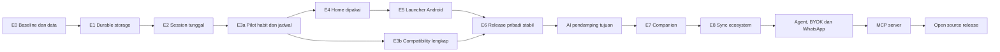

# Long build: dari keadaan sekarang sampai dipakai sehari-hari

Tanggal: 4 November 2026. Status: rencana kerja bertahap; milestone dan release tetap menunggu bukti gate masing-masing. Dependency dan gate lebih penting daripada nomor versi pemasaran. Detail task implementasi ditulis per slice setelah keputusan upstream disetujui, bukan membuat ribuan baris pseudocode untuk seluruh ekosistem sekarang.

## Jalur kerja

Perubahan UI exploratif/read-only boleh berjalan saat E1/E2 diselesaikan. Penggantian Home produksi menunggu data/sesi yang dipakai UI lulus. E5 dapat mulai memperbaiki launch failure/favorit setelah kontrak preferences E1 jelas; final launcher tetap melewati gate E4–E6.

## E0 — Baseline yang dapat dikembalikan

**Hasil:** satu sumber build, referensi UI dan inventaris data yang bisa diperiksa. Tidak mengubah model produk atau membuang data. Status masih parsial karena perangkat dan backup data belum tersedia.

**Lokasi yang ditinjau:** `lib/main.dart`, `main_fitrah.dart`, `main_sadar.dart`, `package.json`, `vercel.json`, `.github/workflows/`, `pubspec.lock`, `lib/models/*.g.dart`, manifest Android dan signing config. Referensi visual dial dari OWNER-INTENT.

- [ ] Rekam Git status, commit, toolchain Flutter/Dart/JDK/Gradle/AGP/Kotlin, min/compile/target SDK, resolved dependencies dan APK yang dipakai Fahim. Pisahkan dirty build artifacts dari source; jangan reset pekerjaan yang sudah ada.
- [ ] Pilih entrypoint Android utama dan feature flags yang benar-benar didukung. Tentukan directory output untuk Fitrah, Focus dan Sadar sehingga build berikutnya tidak menimpa deployment lain.
- [ ] Inventaris state per layar, data DB, secure preferences, volatile collections dan timer owners. Beri label implemented/source-only, verified-runtime, broken atau historical.
- [ ] Rekam nama/ID schema/index Isar existing dan prosedur generator; bandingkan clean generation dalam checkout sementara dengan schema yang dipakai release. Gagal bila generation mengubah identitas DB secara tak terencana.
- [ ] Ambil backup yang konsisten dari instalasi existing sebelum upgrade; tetapkan fixture tersanitasi untuk migration check. Data volatile yang sudah hilang tidak boleh disebut bisa dipulihkan dari DB.
- [ ] Rekam perangkat, OS, font scale, resolusi, dataset realistis dan screenshot dial yang disepakati sebagai baseline.

**Gate:** clean checkout dengan toolchain yang dicatat menghasilkan artifact dengan entrypoint/identity yang benar. Data backup dapat dibaca; fixture memuat setidaknya habit timed/count/binary/progression/hybrid, jadwal recurring dan sesi paused. Screenshot baseline terbuka untuk review. Tidak ada klaim “semua fitur selesai” dari build berhasil saja.

**Rollback:** baseline source/binary tersimpan. Upgrade data belum dilakukan, sehingga revert UI/source tidak membutuhkan downgrade schema.

## E1 — Penyimpanan yang tidak berbohong

**Hasil:** keputusan storage dan jalur read/write yang durable dengan kontrak serta recovery yang sama di semua modul core.

**Lokasi:** `lib/data/isar_service.dart`, repository existing, `providers/`, launcher settings, model IDs, bootstrap main. File kontrak/adapters baru hanya sebanyak yang perlu untuk mengganti jalur yang sedang disentuh.

- [ ] Tetapkan UUID mapping untuk entitas legacy, LocalDate/timezone dan TargetSnapshot sesuai ARCHITECTURE. Nama koleksi Isar existing dipertahankan; migration proof lintas perangkat masih terbuka.
- [x] Spike native storage: Isar Community 3.4.1 dipakai pada Android setelah Isar 3.1 binary menampilkan peringatan alignment 16 KB. Browser adapter versus satu storage lintas platform belum dipilih; lihat [ADR E1](decisions/ADR-E1-storage.md).
- [ ] Definisikan Result/error contracts dan command success sesudah commit. Ganti silent memory fallback produksi dengan recovery state serta retry; test/demo tetap eksplisit.
- [ ] Definisikan export versioned dan import preview/validation. Uji referential integrity, duplicate IDs, versi lebih baru, file rusak, disk penuh/write failure.
- [ ] Buat migrasi awal yang non-destruktif dari data existing dan save draft yang dapat dipulihkan. Jangan memindahkan tiga app private DB seolah lokasinya satu.

**Slice selesai:** bootstrap storage yang gagal sekarang membuka layar pemulihan dengan retry pada ketiga entry point, tanpa fallback memory pada production. Instalasi native lama berhasil di-upgrade ke Isar Community 3.4.1 di emulator yang sama; database settings lama terbuka tanpa error Isar. APK telah dibangun untuk Android 16 KB dan alignment setiap LOAD segment `libisar.so` x86_64 adalah 0x4000. Backup user, device riil, dan persistensi web belum diverifikasi; E0/E1 tetap terbuka.

**Slice backup/restore (5 Nov 2026):** Settings kini menyediakan ekspor JSON berversi dengan checksum dan pratinjau impor sebelum replace. Codec meliputi delapan koleksi Isar serta focus goal; tidak mengekspor kredensial AI/endpoint, menjaga kredensial instalasi saat restore, mempertahankan ID dan data refleksi, serta memulihkan timer aktif dalam status paused dengan waktu kerja yang sudah berjalan. Restore membuat recovery copy lokal sebelum transaksi database; kegagalan preferensi memicu kompensasi database. Uji mencakup checksum/version/ID/tanggal/waktu, daftar backup yang read-only, stale soft references, pemulihan transaksi Isar saat exception, kegagalan secure storage, dan reload provider launcher. Full suite awal: 119 tes lulus; setelah route Settings ditambahkan full suite: 121 tes lulus; `flutter analyze --no-pub` bersih. Android arm64 release APK awal berhasil dibuat: `build/app/outputs/flutter-apk/app-release.apk`, SHA-256 `6bfe6751be7ef90de21b817f3a4ab488d9eb204d76661e1efb86327c98ef17c9`. Web JS release compile berhasil di `/tmp/focus-clock-backup-web-final`; ini hanya bukti kompilasi karena Isar browser belum mendukung persistence. Pada 6 Nov, smoke test emulator Android membuktikan Settings Focus Clock dapat dibuka dari menu utama, ekspor melalui Android Save As, pemilihan JSON melalui DocumentsUI, preview isi backup, replace sukses, serta pembuatan recovery file privat sebelum restore. Yang dipakai backup kosong buatan emulator; ini belum membuktikan round-trip data pemakaian nyata atau upgrade/close-reopen pada perangkat fisik. Route Settings kini memiliki tes widget dan fallback auth tidak mengakses Firebase sebelum dikonfigurasi. APK arm64 release terbaru dibangun ulang setelah route Settings dan auth fallback; SHA-256 `6981b7ec2e8071040eb8d3660c518dead0c7d22bf4b586bef53f518716403648`. Kompilasi web JS terbaru berhasil di `/tmp/focus-clock-backup-web-final2`; ini tetap compile-only, bukan bukti persistence. Browser persistence dan close/reopen plus round-trip record nyata tetap terbuka.

**Slice browser storage (6 Nov 2026):** prototipe terisolasi `tool/web_storage_spike/` membuktikan kandidat Drift WASM melalui enam tes Chromium serta journey dua tab nyata. Goal/timer bertahan setelah page reload, completion dan kontribusi atomik/idempotent, rollback tidak meninggalkan data separuh, watcher menerima commit dari koneksi lain, dan hanya satu tab menang memulai sesi. Dua konfigurasi hosting lokal lulus: `sharedIndexedDb` tanpa COOP/COEP dan `opfsLocks` dengan header isolasi. Paket mempunyai lockfile, aset rilis dengan checksum, dan runner lokal tanpa dependency npm. Lihat [ADR E1](decisions/ADR-E1-storage.md) dan [hasil/commands spike](../../../tool/web_storage_spike/README.md). Kandidat adapter browser dipilih untuk implementasi sambil mempertahankan Isar native. App produksi belum terhubung; delapan model, migration, backup/recovery, eviction/quota, offline startup dari cache dan deploy tetap terbuka.

**Slice browser produksi (7 Nov 2026):** delapan model, repository/provider, tiga bootstrap dan backup/recovery kini memakai adapter browser Drift WASM; Android tetap Isar. Chromium 150 journey dua tab memakai build web dari kode produksi: data serta goal bertahan setelah reload, hanya satu Habit/Activity timer dapat dimulai, completion menyimpan tepat 67 detik sekali, tab yang kalah dapat memulai sesi berikutnya, tidak ada Activity yatim, recurrence/exclusion, rollback/watcher, restore dan ekspor recovery bertahan. Preference failure mengompensasi data dan recovery JSON dapat dibaca setelah reload tanpa kredensial sintetis. Mode terukur `sharedIndexedDb`. Full suite: 124 tes lulus, tes storage unavailable/retry lulus; `flutter analyze --no-pub` bersih setelah lint adapter/harness diperbaiki; Home web JS compile berhasil di `/tmp/focus-clock-browser-production-home-20261107`; worker/WASM cocok dengan checksum Drift 2.35.3. APK arm64 release tersedia di `build/app/outputs/flutter-apk/app-release.apk`, SHA-256 `329954a9300e810233e531ba9dd4d842b15939aae4d121094ac1041a5c8fcd47`; LOAD alignment `libisar.so` 0x4000. Offline dari cache, quota/eviction, Safari/mobile, deploy dan perangkat fisik masih terbuka; E1/E6 belum lulus. Lihat [ADR E1](decisions/ADR-E1-storage.md) dan [runner/fixture](../../../tool/browser_storage/browser_journeys.mjs).

**Gate:** close/reopen benar-benar mempertahankan perubahan pada Android. Adapter web, jika dipilih, lulus reload/offline dan transaksi completion; jika belum lulus, web tetap demo berlabel, bukan produk persisten. Round-trip backup mempertahankan ID/count/status/duration. Injected failure tidak menampilkan Tersimpan. Lulus check ini sebelum E2/E3 schema produk diperluas.

**Catatan riset awal (4 Nov 2026):** Dokumentasi Isar menjelaskan operasi write memakai transaksi dan migrasi perubahan data perlu ditulis sendiri; perubahan skema otomatis tidak membuktikan transformasi data produk ([transactions](https://isar.dev/transactions.html), [data migration](https://isar.dev/recipes/data_migration.html)). Drift WASM di web memerlukan aset SQLite WASM dan worker yang versinya cocok, header MIME yang benar, serta storage probe; OPFS mode memakai COOP/COEP dan punya fallback berbeda termasuk in-memory ([Drift web](https://drift.simonbinder.eu/platforms/web/)).

**Temuan/fix native schema dan Android (4 Nov 2026):** Isolated Linux host test reproduced `IllegalArg: Collection id is invalid` at `Isar.open`. Committed generated IDs did not match the XXH3 hash of unchanged collection names; history shows bounded IDs were introduced for Dart-to-JS compatibility. Generated exact hashes are kept JavaScript-safe by `tool/fix_isar_schema_ids.dart`; after code generation, run that transformer. `test/isar_service_persistence_test.dart` opens the full store, confirms only AppSettings is seeded, inserts an Activity, closes/reopens, and reads the same ID/title/date. Native persistence passes on Linux. Isar 3.1's Android x86_64 binary raised a 16 KB compatibility dialog; the app was upgraded in place to `isar_community` / `_flutter_libs` 3.4.1. Existing settings DB opened after upgrade, the warning disappeared, and `readelf` verified arm64 `libisar.so` LOAD alignment at 0x4000. Latest unified launcher arm64 debug APK `build/app/outputs/flutter-apk/app-arm64-v8a-debug.apk` SHA-256 `40003ccd1b4b5f50ed09eb97109ca8d65e4488838973e267f3a9654776610a94` (118 MiB). Build dependency file confirms it includes `sadar_timer_view.dart`; the Flutter kernel timestamp is newer than the source. `flutter build web --no-pub --no-wasm-dry-run --output=/tmp/focus-clock-web-unified --release` compiles the standard JS target; Wasm is not supported. Community Isar's web implementation still throws UnsupportedError and app startup reaches storage recovery, so web compile is not web persistence. `flutter analyze --no-pub` is clean and all 85 tests pass, including Home habit Play opening the shared Sadar timer. No Android device is currently attached for install verification. E1 remains open for browser persistence, backup/export recovery and physical-device verification.

**Keputusan yang diblokir sampai gate:** pilihan database produksi, schema migration detail dan tanggal release web. Jangan menulis adapter lain berdasarkan dugaan masing-masing.

## E2 — Satu sesi fokus yang dapat dipercaya

**Hasil:** dari semua titik masuk, user mendapat satu state sesi dan catatan actual duration yang sama.

**Lokasi:** `services/sadar_timer_engine.dart`, `models/timer_session.dart`, `providers/providers.dart` quick timer fields, `widgets/quick_timer_hub.dart`, `features/focusclock/widgets/focus_session_view.dart`, `features/sadar/widgets/sadar_timer_view.dart`, `features/sadar/widgets/sadar_ypt_focus_view.dart`, `features/launcher/widgets/focus_clock_home_view.dart`, `sadar_repository.dart`, native clock/reminder bridge.

- [x] Simpan `attributionLocalDate` saat sesi dimulai, pulihkan nilainya dari sesi tersimpan, dan gunakan tanggal itu saat kontribusi habit dicatat. Sesi legacy tanpa field baru memakai tanggal awal yang tersimpan sebagai fallback.
- [x] Simpan total detik timer pada `HabitEntry`, bukan hanya menit bulat; gabungkan sesi sub-menit dan konversi data timer lama dari menit yang masih tersedia.
- [ ] Pisahkan lifecycle record dari running segment/checkpoint lebih lanjut. Tambahkan clock port terkontrol untuk unit checks; Android monotonic interval/same-boot recovery harus nyata, bukan asumsi semua DateTime delta aman.
- [ ] Ubah engine existing menjadi satu SessionCoordinator atau adapter menuju satu owner baru. Jangan mempertahankan dua owner aktif selama rollout; gunakan satu feature switch untuk consumer yang sudah dialihkan.
- [ ] Implement start/pause/resume/end/recover dengan operation receipts, revisions dan transaction single-active pointer. Pasang guard ketika startup restore masih berjalan.
- [ ] Simpan ledger sesi dan kontribusi atomik, lalu side effects notifikasi. Finish early mencatat actual, tanpa menaikkan ke target/minimum 15 menit.
- [ ] Alihkan satu jalur habit Play sampai selesai sebagai vertical slice. Setelah lulus, alihkan Home, QuickTimerHub, dial/fullscreen dan notification actions ke owner yang sama. Hapus duplicate countdown owner sesudah parity, pertahankan UI terpilih.
- [ ] Jadwalkan pengingat OS sesuai izin. Verifikasi cancel/pause/resume membatalkan alarm lama dan stale action tidak mengubah sesi baru.
- [ ] Persist desired reminder state bersama session commit dan rekonsiliasi saat startup/resume/perubahan izin/boot yang diizinkan. Inject crash sebelum OS registration untuk membuktikan retry tidak menggandakan atau kehilangan reminder.

**Checks bermakna:** start ganda; start sesi lain saat running/paused; pause/resume berulang; finish 8 menit dari target 45; dua sesi habit yang sama; crash di antara commit dan side effect; storage error; background/sleep; process death; tengah malam; change clock/timezone; reboot; stale notification. Terpisahkan test deterministic state machine dari device/OS checks.

**Gate:** satu status terlihat di seluruh entry points, ledger tidak dobel, sesi survive reopen, penghentian awal tidak mengklaim 45 menit. Reboot/clock uncertainty meminta review. Notifikasi bukan syarat penyimpanan sesi.

**Slice interim:** Play pada habit grid Home, Sadar habit grid dan quick action membuka `SadarTimerView` memakai `SadarTimerEngine`. Home free/preset dan scheduled Activity timers, `QuickTimerHub`, command palette, voice-created Activity timers, FocusSessionView, dan YPT kini memakai engine yang sama. `TimerSession` menambah source kind nullable, Activity ID, running-segment checkpoint, dan `attributionLocalDate`; tanggal lokal saat mulai dipakai lagi setelah restore agar perubahan tanggal perangkat tidak memindah kontribusi habit. Sesi legacy tanpa tanggal memakai `startedAt` tersimpan sebagai fallback. `HabitEntry.actualDurationSeconds` menyimpan total detik timer, sehingga beberapa sesi pendek tidak dibuang oleh pembulatan tiap sesi; entry timer lama memakai menit bulatnya untuk melanjutkan total. Ini agregat harian, belum ledger per sesi. Row lama tanpa source kind dipulihkan sebagai habit. YPT menggunakan source kind tersendiri yang ditambahkan di akhir enum agar index yang tersimpan tetap stabil. Target YPT beralih ke waktu ekstra tanpa menutup sesi atau mencatat terlalu dini; sesi overtime pulih tetap berjalan setelah app dibuka ulang, dan tombol selesai menyimpan actual duration melalui transaksi timer habit yang sama. Guard foreground app, immersive screen dan emergency hold tetap ada; emergency exit menghapus sesi yang aktif setelah penyimpanan berhasil. QuickTimerHub membuat Activity saat mulai; pause/resume menunggu commit; durasi tambah dipersistenkan; Activity completion menyimpan actual seconds dan memperbarui Activity ID yang tepat dalam transaksi bersama penghapusan sesi. FocusSessionView memulai Activity ID yang tepat, memakai state pause/resume/actual dari engine, dan menampilkan retry bila completion belum tersimpan. Test state machine, Home, QuickTimerHub, FocusSessionView, YPT, repository dan Isar reopen/transaction lulus; analyzer bersih. Full suite terbaru: 108 tests pass.

E2 tetap terbuka: semua consumer timer yang saat ini ada memakai owner yang sama, tanggal atribusi lokal tersimpan setelah Isar reopen, dan HabitEntry mengagregasi total detik timer. Clock monotonic/same-boot, timezone ID/offset snapshot, operation receipts/revisions, ledger detail per sesi, notification reconciliation, device recovery UI, reboot/process-death uncertainty dan physical Android checks belum diverifikasi. Home preset completion membuat Activity row(s) dan menghapus TimerSession dalam transaksi Isar yang sama; failure injection membuktikan sesi tetap aktif sampai retry sukses dan retry tidak menggandakan Activity. Jangan anggap satu owner saja menutup gate E2.

## E3 — Habit, tindakan, jadwal dan tujuan tersambung

**Hasil:** user dapat memilih habit atau task yang sama dari Home, grid dan dial, menjalankannya, lalu melihat bukti yang sama.

**Lokasi:** model Goal baru bila E1 memutuskan format, `habit.dart`, `habit_entry.dart`, `task.dart`, `activity.dart`/Schedule adapter, Sadar/Activity/Task repositories, `loop_habit_grid_widget.dart`, Home local `HabitModel`/`BlockItem`/`PresetItem`, notes/inbox persistence.

**Bagi menjadi E3a dan E3b.** E3a menyelesaikan satu loop timed/binary end-to-end, Goal/TodaySelection, satu jadwal logis, backup dan read-only preservation seluruh legacy data. Itu pilot U0 pertama: Fahim dapat membuka dan memakai satu kegiatan nyata sebelum semua editor lengkap. E3b menyelesaikan progression/hybrid/count, recurrence editing, inbox/note/reflection dan migrasi compatibility yang tersisa. E4 boleh berjalan setelah E3a; E6 menunggu E3b. Jenis yang belum didukung pada pilot mempunyai status jelas dan akses baca/ekspor, tanpa tombol yang berpura-pura bekerja.

**Slice Home habit (7 Nov 2026):** Home produksi hanya menampilkan grid habit yang memakai repository Sadar; bagian habit kedua yang hanya hidup di memori tersedia untuk fixture preview saja. Form grid menunggu penyimpanan, mempertahankan input dan menampilkan error bila gagal, serta mengunci form saat write berlangsung. Kolom deskripsi yang tidak punya tempat penyimpanan dihapus dari form. Dua puluh tes Home/habit lulus; dua tes save/retry dan pencegahan dismiss saat write lulus sesudah review; analyzer bersih. Ini belum menutup gate E3.

**Slice catatan Home (7 Nov 2026):** catatan tersimpan per tanggal lokal, terpisah dari refleksi Sadar, dan memperlihatkan status simpan serta retry. Draft yang gagal tetap dapat diakses setelah Home dibuka ulang atau melewati tengah malam. Penulisan pengaturan lokal, ekspor dan restore memakai antrean; ekspor menolak draft yang belum tersimpan. Backup v2 membawa catatan, sedangkan backup v1 tetap dapat diimpor. Dua puluh empat tes fokus catatan/backup dan analyzer lulus; perilaku preferences di beberapa tab browser dan perangkat fisik masih perlu diuji.

- [ ] Implement Goal optional links, pinned cue dan durable TodaySelection per tanggal tanpa wizard wajib. Import `focusGoal` legacy melalui versioned mapping `(sourceStoreId, entityType, legacyKey)` bila datanya tersedia; jangan menebak link dari description/title. Re-import fixture yang sama harus idempotent, angka ID sama dari instalasi berbeda tetap berbeda.
- [ ] Tetapkan occurrence/series identity, target snapshots, habit recurrence dan archive behavior. Migrasi status history tanpa menggantinya dengan target hari ini.
- [ ] Selesaikan binary/count/timed path; progression/hybrid mempertahankan step/unit/rest dan menghindari duplicate advancement. Jangan tampilkan Play pada handler yang belum mendukung jenisnya.
- [ ] Ganti local collections Home satu per satu dengan live repository bindings. Jadwal menunggu commit sebelum UI sukses; ID local dan DB tidak dibangkitkan terpisah.
- [ ] Satu ScheduleBlock logis punya adapter 12/24h, midnight dan recurring editing yang benar. Reuse dial/time_math; jangan mengganti renderer untuk memperbaiki model waktu.
- [ ] Persist Task inbox, Note dan Reflection. Jadwalkan existing Task dengan ID asli; pindah/unschedule tidak membuat duplikasi.
- [ ] Today's projection membaca tanggal aktual, session, pin user, agenda dan occurrences. Buka tanggal historis tanpa memengaruhi status Hari Ini.

**Gate:** Goal → habit LKS → jadwalkan → start → 8 menit → end → history terukur. Binary done tidak menghasilkan menit palsu. Progression double tap hanya maju satu occurrence. Dua jadwal dengan judul sama tetap punya identitas berbeda. Mengubah target/arsip hari ini tidak menulis ulang riwayat kemarin.

**Slice tujuan dan pilihan hari ini (8 Nov 2026):** Home produksi membaca goals UUID, tautan habit/task eksplisit dan TodaySelection per tanggal aktual dari satu aggregate FocusStore. Tujuan dapat dibuat, diganti nama, disematkan atau diarsipkan; arsip tidak menghapus sumber maupun pilihan historis. Cue mendahulukan sesi aktif/dijeda, lalu tindakan terpilih yang belum selesai, lalu agenda berlabel direncanakan. Habit timed memakai engine yang sama; binary/count mencatat unit tanpa menciptakan durasi dan mempertahankan bukti durasi existing. Task membuka penjadwalan ID tepat atau blok existing bila sudah dijadwalkan. Progression/hybrid tetap dipertahankan dengan penjelasan dukungan, tanpa completion palsu. Import legacy menunggu hidrasi preferences, menyimpan marker/mapping, dan tidak mengulang pada perubahan catatan. Backup v3 membawa aggregate dan identitas sumber; v1/v2 tetap dibaca, restore lama menghasilkan identitas deterministik dari fingerprint file dan memperbarui stream Home, termasuk compensation. Verifikasi fokus: 36 tes matriks native/repository/widget/inbox/scheduling, 52 tes tambahan intent/backup/codec/Sadar (cakupan beririsan), dan 13 tes regresi catatan/Home lulus. Compile JS web ke `/tmp/focus-clock-intent-web-final-20261108` lulus; runtime browser tidak dijalankan karena pembatasan akses sebelumnya. Verifikasi perangkat Android, visual/TalkBack dan runtime browser tetap terbuka; ini bukan penutupan gate E3/E4.

**Slice bukti habit terjadwal (9 Nov 2026):** Habit timed/min dari penyimpanan nyata kini dapat dijadwalkan melalui cue pilihan Home dan picker jadwal. Tiap segmen menyimpan `Activity.habitId`; start dari Activity membekukan ID habit dan target menit dalam sesi durable yang sama. End 480 detik dari target 45 menit mencatat partial, bukan fulfilled; kontribusi submenit dijumlah tepat dan target occurrence existing dipertahankan. Completion habit + Activity + clear sesi berada dalam satu transaksi; kegagalan setelah write pertama rollback, retry tidak menggandakan kredit. Perubahan nama/arsip/target setelah start tidak memindahkan bukti. Bila sumber blok diganti saat sesi aktif, bukti ditulis sebagai actual occurrence dengan sumber asli dan rencana yang diedit dipertahankan. Sesi tambahan pada blok yang sama menambah actual seconds sekali. Backup v4 membawa linkage/snapshot baru; v1–v3 dan live record lama tetap dibaca tanpa menebak linkage. Fixture native sintetis baseline `4e20c90` dibuka dengan schema baru tanpa kehilangan ID/nilai/sesi paused; collection/index identities tetap sama. Verifikasi fokus native/repository/engine/backup dan Home/session widget lulus; analyzer bersih. Compile web ke `/tmp/fitrah-scheduled-habit-evidence-web` lulus. Batas slice: belum ledger sesi terminal, belum penutupan seluruh E3/E4; binary/count tetap manual dan progression/hybrid tidak dikonversi ke menit. Pengujian perangkat Android, TalkBack/visual dan runtime browser tetap terbuka karena akses browser sebelumnya dibatasi.

**Slice tindakan habit Home (9 Nov 2026):** Grid kini memilih tindakan sesuai unit: Play hanya timed/min dengan callback dan tanggal hari ini, binary menandai/batal selesai tanpa menit buatan, count mengedit jumlah total 0–9999 pada ID/tanggal yang dipilih. Target count dibaca dari occurrence tersimpan di dalam transaksi; increment memakai transaksi yang sama. Manual status mempertahankan durasi existing secara default dan menjaga detik terukur, termasuk memulihkan detik dari menit timer legacy sebelum source berubah. API catatan hanya mengubah note/updatedAt pada entry existing; entry baru tetap unmarked dengan durasi nol. Editor catatan/count menunggu commit, menahan input/error untuk retry, serta memblokir Back/dismiss/submit berulang saat pending. Progression/hybrid menampilkan langkah/rest atau set/durasi dan batas dukungan yang jujur; eksekusi occurrence penuh masih terbuka. Palet dan grid riwayat dipertahankan.

Verifikasi slice: `home_habit_repository_test.dart` menjalankan kasus yang sama pada preview eksplisit dan Isar native (16 tes: note-only unmarked/yes/skip, clear note, exact seconds/target, reopen persisted, zero invented time, target count beku, atomic increment, validasi sumber/arsip/input). `home_habit_actions_test.dart` lulus 8 tes widget: callback ID tepat, tanggal historis, count partial→fulfilled/same-name identity/input invalid/failure/pending/retry, note failure/pending Back/dismiss/retry, status failure/retry, serta kontrol 320dp/200% dengan target sentuh minimal 48dp. Tes terkait save/cue/repository/scheduled evidence lulus (51 pada run awal, termasuk 6 kasus repository baru sebelum perluasan); session contract/shared timer/state machine juga lulus pada run fokus 43 tes yang beririsan. Analyzer bersih dan diff whitespace diperiksa. Native di sini berarti Isar Linux test, bukan verifikasi perangkat Android. Browser/runtime/device visual dan TalkBack belum diperiksa; penolakan akses browser sebelumnya tetap dihormati. Tidak ada schema migration atau pembersihan riwayat, dan gate E3/E4 belum ditutup.

## E4 — Home yang enak dibaca dan dioperasikan

**Hasil:** rancangan Home yang disetujui pemilik memakai data sungguhan. Habits, dial dan tujuan mendapat hierarki yang jelas.

**Lokasi:** `fitrah_launcher_shell.dart`, Home widget, `loop_habit_grid_widget.dart`, `core/theme.dart`, NowNext/session summary dan editor terkait. Extract widget sesuai tanggung jawab yang sedang disentuh; jangan melakukan refactor semua app sekaligus.

- [x] Review [mockup](mockups/today.html) sebagai hierarki. Pemilik menyetujui susunannya dengan arahan mempertahankan palette, bookpaper dan clock face Focus Clock yang sudah dipilih.
- [x] Tambahkan cue tujuan editable ke Home dan simpan dalam LauncherSettings lokal; kegagalan simpan ditampilkan dan nilai sebelumnya dipulihkan. Pilihan `full_book` tetap memakai dial Warm Journal yang sudah ada.
- [ ] Capture Flutter dengan dataset sama dan review goal/dial/habit placement sebelum implementasi menyebar.
- [ ] Terapkan semantic tokens, font bundled/platform, TextScaler dan single primary action per konteks. Hapus rail tools duplikat dari hero; taruh aksi di konteksnya.
- [ ] Home memakai reusable habit row yang membaca progress measured/manual dan aksi unit-safe. Destination Habits memuat detail/history; Home tetap dapat start/check-in.
- [ ] Sediakan visible navigation, Back yang konsisten, inbox capture singkat, settings satu jalur dan session summary lintas destination.
- [ ] Kerjakan state empty, loading, busy, failed, restored, paused, target reached dan uncertain recovery. Jangan menunda ini sesudah screenshot happy path.
- [ ] Uji glance dengan Fahim, long titles, banyak habits, font 200%, lebar 320 dp, landscape, keyboard dan TalkBack. Dial punya daftar setara.

**Gate:** Fahim menemukan tujuan/status/aksi tanpa bantuan penjelasan builder; memulai habitual focus tidak membutuhkan settings. Tidak ada overflow/aksi tertutup/gesture-only workflow pada kondisi yang disepakati. screenshot sebelum/sesudah dan feedback dicatat. Gate visual tidak mengklaim persistence tanpa bukti E1–E3.

**Slice interim — honest Hari Ini data (4 Nov 2026):** Isar no longer inserts generic presets or habits; AppSettings initialization remains. Production Home starts without an assumed identity or sleep blocks, and the agenda carousel, dial, chronological list and current schedule label consume the same `activitiesByDateProvider` projection. Empty, loading and error states have explicit copy; `useSampleData` builds preview Activity objects in memory only. Home create/check-complete/delete paths use `ActivityRepository` outside preview; conflict checks use persisted rows; timer completion commits the same Activity and prevents duplicate finish writes. Home's persisted habit Play now opens the durable Sadar session screen. Full suite: 85 tests passing; `flutter analyze --no-pub`, Android arm64 debug build and web JS compile pass. Latest arm64 APK: `build/app/outputs/flutter-apk/app-arm64-v8a-debug.apk`, SHA-256 `40003ccd1b4b5f50ed09eb97109ca8d65e4488838973e267f3a9654776610a94`. Device install verification, browser storage, backup recovery, reboot/upgrade behavior and full E4 glance checks remain open. E0/E1/E2 and E4 gates remain open.

## E5 — Fitrah menjadi launcher yang dapat dipakai

**Hasil:** user dapat menjadikan Fitrah default Home tanpa kehilangan akses aplikasi atau konteks sesi.

**Lokasi:** `minimalist_app_drawer.dart`, `app_launcher_service.dart`, launcher preferences/settings, `MainActivity.kt`, Android manifests/styles dan lifecycle shell.

**Slice capability launcher (9 Nov 2026):** Service tidak lagi mengganti kegagalan Android dengan daftar contoh atau mengaku berhasil membuka aplikasi di web/desktop. Daftar nyata divalidasi, diurutkan dan dideduplikasi menurut package; payload kosong valid dibedakan dari payload rusak. Aksi aplikasi/utilitas/pengaturan memakai hasil dispatch bool dan feedback kegagalan yang sama, termasuk setelah sheet ditutup. Retry dan resume memuat ulang daftar serta ikon; completion ikon lama tidak mengisi kembali cache yang sudah di-refresh. Cache ikon native juga dikosongkan saat listing diperbarui. Pilihan allowed apps tetap dipertahankan saat daftar gagal. Default Home role, favorites/hidden/order durable, scrubber dan audit permission penuh masih terbuka.

Verifikasi setelah review: 29 tes launcher/provider/widget/session lulus, analyzer bersih (12,5 detik), dan compile web JavaScript lulus (51,7 detik). Cakupan termasuk layar YPT 320dp/200% dengan pesan gagal yang dapat digulir dan target sentuh 48dp kontrol Sadar legacy. Tes lama yang bergantung pada daftar contoh kini memakai fixture eksplisit dan tetap memeriksa hasil pencarian. Native QA terpisah API36 berhasil memasang dan membuka checkpoint **c8b1087**, menolak izin notifikasi, membuat serta menyematkan tujuan QA, lalu mempertahankannya sesudah force-stop/cold restart; ini bukan bukti runtime perubahan capability terbaru. AVD harian `Medium_Phone` tidak diubah. Runtime browser, upgrade harian/perangkat fisik dan gate E5 keseluruhan belum selesai. Lihat [setup dan bukti native QA](NATIVE-QA.md).

- [ ] App list Android asli, refresh ketika app ditambah/dihapus atau launcher resume, label serta icon yang benar. Listing failure menghasilkan error/retry, bukan daftar simulasi.
- [ ] Tunggu dan periksa launch result; tampilkan not-installed/unavailable/error yang tepat. App info/uninstall memakai UI sistem; kembali ke app refresh availability.
- [ ] Persist favorites/hidden/order. Jangan mengandalkan package dialer/camera tertentu ada pada semua vendor; intent berbasis capability dengan hasil yang dilaporkan.
- [ ] Search/clear/Back bekerja, keyboard tidak menutup hasil terakhir. Scrubber melompat ke kelompok aktual, bukan estimasi offset 130+index×56 yang salah ketika header/teks berubah.
- [ ] Request/verifikasi default Home role. Audit manifest utama dan manifest `src/fitrah` yang masih menyebut activity lama; hanya source set/flavor yang benar-benar dikonfigurasi masuk artifact.
- [ ] Pastikan Home intent dan unlock biasa tidak membuka fullscreen timer/lockscreen overlay tanpa permintaan user. Wallpaper terang/gelap memiliki keterbacaan memadai.
- [ ] Pisahkan permission yang benar-benar diperlukan dari fitur opsional; app listing/launch tidak memerlukan app-blocking feature hanya karena manifest memuat permission-nya.

**Gate:** default Home pada perangkat harian, reboot, buka app, search, launch, app info, install/uninstall dan kembali Home semuanya dapat diselesaikan. Jika suatu vendor menolak capability, launcher menunjukkan recovery. Sesi yang aktif tetap sama.

## E6 — Rilis pribadi stabil

**Hasil:** Fahim bisa menggunakan build harian dan upgrade dengan data utuh.

- [ ] Buat release/profile build dengan signing identity yang bisa meng-upgrade instalasi acuan. Putuskan public signing terpisah; jangan mengganti key/app ID diam-diam.
- [ ] Verifikasi offline core, restart, reboot, denial notifikasi/alarm, storage failure, battery restrictions, dan font/warna/ukuran layar. Force stop dicatat sebagai OS boundary, bukan kegagalan timer yang bisa dijanjikan hilang.
- [ ] Ukur startup/resume/frame behavior dengan perangkat/dataset E0; tick timer tidak rebuild seluruh Home/grid. Tindaklanjuti bottleneck yang diukur.
- [ ] Jalankan fixture migrasi dan export/import round-trip. Rehearse recovery pada salinan data, jangan eksperimen dengan satu-satunya DB harian.
- [ ] Fahim memakai app minimal tujuh hari dengan goals/habits miliknya. Catat setiap aksi mati, keadaan salah, kehilangan data dan kebutuhan menyiasati app.
- [ ] Perbaiki data loss, durasi salah, crash, launcher exit/unusable dan aksesibilitas blocking sebelum menambah fitur baru. Update README/capability matrix dengan bukti rilis aktual.

**Gate:** tidak ada isu data loss/credit salah/core dead action yang terbuka. Loop UJ-1–UJ-6 dapat dilakukan tanpa langkah workaround. Riwayat dan session records dari penggunaan nyata tetap dapat dibaca sesudah upgrade. Ini baru definisi “enak dipakai” rilis pribadi; public rollout memerlukan gate distribusi sendiri.

## E6a — Pendamping tujuan dan perencana

**Hasil:** user dapat bercerita atau menyebut tujuan, melihat rangkuman yang dapat dikoreksi, menerima draft langkah/jadwal yang realistis, lalu memilih sendiri apakah akan menerapkannya. Contoh acuan: “Aku ingin menang LKS nasional IT Software Solution, tapi sekolah dan tugas lain juga banyak.”

**Prasyarat:** E1 persistence, E2 session ownership, dan E3 Goal/Habit/Schedule contracts harus memiliki jalur mutasi durable. AI tidak boleh memutasi Home-local shadow state atau menandai kegiatan selesai.

- [ ] Gunakan `AiService`/BYOK yang ada sebagai referensi implementasi, bukan kontrak produk; adapter provider mengeluarkan `GoalUnderstanding` dan `PlanProposal` model-independent.
- [ ] Percakapan dimulai dari input bebas atau “Apa tujuanmu?”; klarifikasi tenggat, kemampuan sekarang, komitmen tetap, ruang harian dan istirahat hanya bila datanya mengubah proposal.
- [ ] Proposal menyebut assumptions, waktu fleksibel, konflik dengan jadwal, dan alasan ringkas; edit/terima/tolak seluruhnya terlihat sebelum commit.
- [ ] Apply proposal lewat use case domain yang sama dengan editor manual, validasi lalu commit atomik/idempotent. AI tidak mengubah bukti habit/session dan tidak menjanjikan hasil lomba.
- [ ] BYOK disimpan pada secure storage yang ada, provider bisa ditukar, dan error/invalid output kembali ke draft serta jalur manual. Core offline tetap bekerja tanpa API.
- [ ] Tidak ada pengiriman percakapan ke provider tanpa aksi user yang jelas; UI menampilkan provider/model yang dipakai dan tidak mencatat prompt privat diam-diam.

**Gate:** cerita → tujuan terkoreksi → draft → edit → setujui → Home cue → satu aktivitas mulai → actual session/history tetap benar. Provider timeout, malformed output dan user menolak proposal tidak mengubah jadwal existing. Jalur tanpa AI tetap dapat menyelesaikan seluruh alur manual.

## E7 — Web dan desktop companion

**Hasil:** user dapat memakai domain yang sama di laptop/browser, dengan batas kemampuan yang jujur.

- [ ] Consumer kedua memakai shared domain/contracts yang sama; ekstrak Dart package bila duplikasi nyata memerlukannya. Jangan copy/paste service baru ke repo Sadar.
- [ ] Adapter storage browser dari E1 dibuktikan reload, offline setelah initial cache, storage unavailable, eviction/export recovery dan multi-tab single-writer. Browser yang menghapus local storage tetap dapat menyebabkan kehilangan data yang belum dibackup; jangan menyebutnya cloud backup.
- [ ] Build target/output/entry point untuk Focus/Sadar/Fitrah terpisah; screenshot dan build metadata membuktikan halaman tujuan. Tidak deploy stale precompiled bundle dari root/`public/` tanpa source build.
- [ ] Capability Android-only tidak disimulasikan sukses. Web session state dapat pulih ketika tab dibuka lagi; alarm saat tab ditutup tidak dijanjikan setara Android.
- [ ] Desktop keyboard/resizable window bekerja. Floating timer ditambahkan hanya bila core session owner yang sama dapat mengendalikannya.

**Gate:** goals/habits/schedule/session tersimpan di setiap target yang dinyatakan didukung; data di perangkat ini diberi label sampai E8. Preview dapat direview sebelum produksi. Pemisahan web views bukan data sync.

## E8 — Ekosistem lintas perangkat dan opsi app terpisah

**Hasil:** bila user menginginkannya, HP dan companion berbagi data dengan batas offline/konflik yang dapat dipahami.

- [ ] Fahim memilih skenario riil (contoh: mulai sesi HP, lanjut laptop, lihat habit dari keduanya). Tentukan kebutuhan akun, biaya dan provider sebelum mengaktifkan Firebase/Supabase/layanan lain. Bukti library existing tidak sama dengan keputusan produk.
- [ ] Bangun adapter sync dengan auth per user, outbox lokal, operation ID, retries, cursor/ack, tombstones, contract version dan log yang tidak memuat isi pribadi. Test unauthorized access pada data lain.
- [ ] Implement online handoff dengan expected revision/ownership ACK. Offline tetap lokal; overlap sessions dipertahankan untuk review, tidak diringkas ganda sebagai jam unik.
- [ ] Gunakan owner epoch fencing, source checkpoint/release dan server CAS. Stale-owner control ditolak; offline evidence tetap disimpan disputed untuk rekonsiliasi. Jangan mengklaim handoff selesai jika perangkat sumber tidak mengakui pelepasan sesi.
- [ ] Uji dua perangkat edit habit offline, rename/archive conflict, replay operation, jaringan putus di tengah ACK, server reset/retry, zone/date berbeda dan sesi overlap.
- [ ] Bila tiga app terpisah masih bermanfaat, pilih data owner/IPC atau backend sebagai ADR distribusi. APK terpisah tidak mengakses private DB satu sama lain secara otomatis. Deep link dibatasi routing dan request tervalidasi.

**Gate:** actual cross-device round-trip dibuktikan pada perangkat nyata, konflik tidak menghapus bukti, log/indikator membedakan local pending dan synced. Login/network tetap bukan syarat core offline. Rilis tiga APK baru menunggu gate ini, bukan dikerjakan paralel dengan pemulihan Android pertama.

## E9 — AI agent, API milik user dan WhatsApp

**Hasil:** user dapat memilih model/provider dengan API key miliknya, mengobrol tentang arah dan tindakan yang berulang, lalu meminta agent menyiapkan perubahan jadwal melalui command domain yang telah disetujui. WhatsApp menjadi kanal opsional yang meminta otorisasi eksplisit.

- [ ] Pertahankan BYOK secure storage; definisikan provider adapter umum, dukungan endpoint/model yang diuji, validasi key, delete/replace, biaya/consent info, serta fallback manual.
- [ ] Pisahkan chat/understanding dari tool actions. Perintah baca dan proposal memiliki batas data; write/action memerlukan preview dan approval untuk setiap perubahan penting. Jangan mengirim Goal, refleksi, lokasi, atau habit tanpa persetujuan yang jelas.
- [ ] Pakai user-selected goal, nilai berulang, tanggung jawab wajib, energi yang user laporkan, waktu nyata dan istirahat sebagai konteks proposal; agent tidak menilai iman/karakter, menjamin lomba, atau memaksa jadwal ekstrem.
- [ ] Implement WhatsApp hanya dengan WhatsApp-supported auth/API/transport setelah verifikasi produk dan biaya; jangan menyimpan session token di chat, membypass encryption, atau menjadikan bot syarat core.
- [ ] Sediakan pause/revoke/delete connection, least-privilege scopes, rate limits, privacy-safe audit receipts dan cara koreksi aksi.

**Gate:** satu provider berhasil, tidak valid, timeout dan limit tercapai dengan keadaan data yang jujur; user dapat ganti key/provider, putus koneksi dan kembali kerja manual. Tool-write tidak berjalan tanpa approval. WhatsApp pesan salah tujuan, token invalid dan revoke tidak bocorkan data atau mengulang aksi.

## E10 — MCP untuk koneksi lintas tools

**Hasil:** client MCP yang dipilih user dapat membaca/menjalankan kemampuan Focus Clock dalam scope yang ia izinkan.

- [ ] Tetapkan resource/read tools dan action tools terpisah, schemas versioned, identifier stabil, permission scopes, pagination, timezone, error semantics, idempotency dan consent transport.
- [ ] Host/server melakukan auth per user dan validasi policy; API key tidak menjadi alasan untuk mengeluarkan seluruh database atau credential provider.
- [ ] Action schedule/session memakai use case domain yang sama dan approval/receipts yang sama seperti app; tool client tidak dapat menyatakan habit selesai dari prompt.
- [ ] Revoke akses mencabut token aktif; logs tidak menyimpan prompt/teks habit kecuali user memilih opt-in. Uji unauthorized read/write, replay, stale revision dan malformed payload.

**Gate:** client independen berhasil discover/read sesuai scope, melakukan proposal yang user setujui, serta menerima penolakan/konflik/revoke tanpa side effect ekstra. Core app tetap tersedia tanpa MCP server.

## E11 — Open-source dan distribusi publik

**Hasil:** source dan artefak publik dapat diambil, dibangun ulang dan dirilis tanpa membawa credential/signing key atau menyebut lisensi yang tidak ada.

- [ ] Audit dependency/license/assets dan notices; pilih lisensi dengan pemilik, tambah `LICENSE`, privacy/security/contribution guidance dan update README hanya dengan kapabilitas yang benar.
- [ ] Pindahkan credential dari tracked config jika ada secret; audit Firebase rules/client restrictions, logs, data samples, generated outputs, embedded preferences dan key storage.
- [ ] Siapkan CI reproducible dengan Flutter/Dart/JDK/SDK versi terkunci, entry point/output matrix yang benar, Linux `libsecret-1-dev`, release signing dari secret, dan checksums.
- [ ] Publikasikan Android/desktop/web hanya jika masing-masing feature/capability lulus; GitHub Release berisi artifact yang konsisten dengan tag dan manifest build. Tag tidak otomatis deploy ke Vercel/production.
- [ ] Pertahankan signing identity pribadi agar APK bisa upgrade; kunci publik release dan private release dipisahkan/ditetapkan jelas sebelum upload. Jangan menimpa artifact/link yang pemilik gunakan tanpa catatan migrasi.

**Gate:** license dan notices valid, clean CI matrix lulus dari checkout bersih, asset checksums cocok, APK publik dapat dipasang/upgrade dengan key yang diumumkan, dan halaman Release memberi file yang benar-benar tersedia. Jika salah satu target belum siap, tandai unsupported alih-alih mempublikasikan klaim palsu.

## Cara builder menerima dan menyerahkan slice

Sebelum coding, tulis satu task kecil berisi requirement ID, file yang disentuh, kontrak yang dikonsumsi, perubahan data, contoh gagal yang akan dibuktikan dan syarat stop. Review kebutuhan visual terhadap DESIGN/EXPERIENCE. Simpan checkpoint source dan backup sebelum migrasi.

Selesai slice ketika behavior dan failure path yang relevan diperiksa. Handoff menyebut perubahan, command/check yang dijalankan, hasil, screenshot bila UI berubah, dan batas yang belum diverifikasi. Source-only audit bukan runtime pass. Jangan menambah dependency, route atau tabel untuk kebutuhan yang belum punya slice.

Rencana ini tidak menetapkan jumlah hari kerja palsu. E0 mengukur kapasitas dan toolchain; sesudahnya pecah milestone aktif menjadi satu atau dua vertical slices yang bisa direview. Estimasi kalender diberikan setelah scope slice dan hasil spike diketahui.

## Checkpoint launcher — 9 November, b89991f

Three implemented slices: persisted favorite/hidden preferences with commit-aware retry and restoration; verified Android default Home state/system selection; native HOME intent routing to the central goal screen. Full Flutter suite: **280 passed** (54 seconds), analyzer clean (8.5 seconds). Reviews found one hydration-header availability issue, fixed and tested; subsequent role/navigation reviews had no actionable findings.

API36 x64 upgraded from QA versionCode12 to14 and demonstrated system Home from Android Settings and launched Android Clock returns to central Home with QA-LKS-Nasional. Goal/favorite upgrade and cold-restart persistence, committed hide/restart/restore and actual role cancel/select were verified; prior versionCode12 also retained role/goal/favorite through actual emulator reboot. New navigation build was not separately reboot-tested. Physical Android, pre29 runtime, TalkBack and ordinary daily use remain gates.

Downloadable preview source: `b89991f`. Folder `release_dist/2026-11-09-b89991f/`: arm64 APK0.5.3 with versionCode15 override (same debug signer), JavaScript web ZIP, manifest and checksums. APK compile137.5 seconds; web compile68.7 seconds. APK SHA256 `b37a42c556e54986c4bd052a133dc00ed44d936b1e256d46fcaaf4fe6def3452`; ZIP SHA256 `9ac8a2f9ecac89c212562d1cd6d464bc22ed02c5f8c10812523b219e9db5f7a6`. Both checksum checks passed. Arm64 phone runtime and browser runtime at this checkpoint remain unverified. Local web preview served on127.0.0.1:4174; no GitHub/Vercel publication.

E5/E6 remain open: several legacy Settings controls still have simulated/local-only behavior, permission requests remain overly early, launcher accessibility and vendor/physical-device behavior need work, and broader session/habit compatibility gates remain. Later AI/BYOK, sync, WhatsApp and MCP scope has not been completed by these launcher slices.

## Checkpoint active Focus Clock Home — 14 November 2026

Commits `c46feeb` (drawer preferences), `df05e82` (shared focus presets), `d147df2` (active wallpaper), `53811bc` (truthful Settings), `71babba`/`2e7a884` (durable Home mode), and `64dde9c` (Home display preferences). The active Home now consumes saved prayer/Focus Events mode, prayer visibility, date/Hijri visibility, current-event visibility, agenda visibility, and habit-grid visibility. Settings mode selection watches committed provider state. The prayer toggle persists and carries a semantic state/label. Regression covers Home toggling and persistence, each Home visibility switch, and the reactive Settings selection. Existing tests that inspect lower Home content now scroll it into the lazy list before assertions.

Full repository suite: **304 passed**; analyzer: **No issues found**; diff check passed. Current local preview: `release_dist/2026-11-14-focus-clock-preview-22/`, pinned by local tag `focus-clock-preview-22` at source `64dde9c`. APK is versionName `0.5.3`, versionCode `22`, arm64-only, minSDK24/targetSDK35/compileSDK36, signed with the existing Android debug certificate. APK compile 140.9s, APK SHA-256 `368dbe7f8450c2f2ed3c921359de9909f0a8fe153b7cd9d00eba72f0b58d4fb4`. Web JavaScript compile 72.8s, ZIP SHA-256 `1eaa5195bfb3d0ca5cce9d36ae335d9bce56827aab768211ef8e383065d6dfdf`; preview `127.0.0.1:4175` returned HTTP200 and ZIP integrity passed.

Runtime caveat: only preview versionCode19 was cold-started on the disposable API36 x86_64 QA AVD. Version22 is compile/package-verified, not device-verified; no physical-device or version22 browser interaction claim. Browser persistence remains unverified, Flutter WebAssembly dry-run still reports dependency incompatibilities. This is a local preview, not a public GitHub/Vercel/Play Store release. E0–E6 adoption/data gates remain open; cross-device sync, AI/BYOK, WhatsApp, MCP and open-source publication are still later milestones.

**Follow-up permission fix:** `NotificationService.init()` no longer requests Android notification permission on app startup. The service checks permission when the user schedules an activity and requests it at that point only if notifications are disabled; a denied prompt is not repeated for each subsequent schedule in the same process. Full suite: **306 passed**; analyzer clean. Channel regression verifies startup, first schedule, same-process denial, and the already-enabled path. Physical/runtime permission UI still needs a fresh disposable AVD run.

## Checkpoint local preview — 14 November 2026 — versionCode 23

Source `8cd5179` defers Android notification permission until the user schedules a future activity reminder. Full suite: **306 passed**, including two focused notification channel regressions; analyzer clean. Android arm64 release APK compiled in 147.1s and passed signature/metadata inspection. Web JavaScript release compiled in 65.7s; ZIP integrity passed and local preview `127.0.0.1:4175` returned HTTP200. Artifacts, SHA-256 checksums and verification limits are recorded in `release_dist/2026-11-14-focus-clock-preview-23/` (ignored local deliverables).

Version23 has not been run on a device or emulator; no physical device is attached. Preview web interactions were not rerun for v23, and HTTP200 is not a browser smoke test. Existing package uses the Android Debug certificate and is for personal preview; it is not a public release. Local tag `focus-clock-preview-23` pins source revision `8cd5179`.

This checkpoint does **not** close the goal. E0–E6 include open adoption, migration, timer, UX and real-device gates. Full owner-phone default Home/reboot/app lifecycle remains unverified. Cross-app sync, AI goal companion, WhatsApp, MCP and public open-source release remain later roadmap milestones.

**E5 permission-scope follow-up:** MainActivity enumerates only activities matching the launcher intent, and the manifest already declares that intent under `<queries>` plus explicit Sadar/Focus packages. Removed the redundant `QUERY_ALL_PACKAGES` broad visibility permission; Android app drawer discovery remains scoped to launchable activities. Needs merged-manifest/package verification and runtime app-list check on Android. This is source-level permission minimization, not a Play policy approval.

**E5 permission-scope follow-up 2:** Removed the unused `SYSTEM_ALERT_WINDOW` declaration and native `checkOverlayPermission`/`openOverlaySettings` handlers. Repository search found no Dart caller; current focus screen uses activity lockscreen/window flags instead of drawing over other apps. APK permission/runtime verification still required for this checkpoint.

Preview25 Android arm64 compiled successfully in 88.0s. The merged APK manifest confirms both `SYSTEM_ALERT_WINDOW` and `QUERY_ALL_PACKAGES` are absent while the Home/launcher intent filter remains. Signature and package metadata verified. Runtime app list/default Home behavior still needs an Android device. Local APK/checkpoint notes/checksum: `release_dist/2026-11-14-focus-clock-preview-25/` (ignored local deliverable).

**E2/E5 YPT access gate follow-up:** If a habit has an app whitelist, Android Usage Access is now checked before a focus session starts. Missing access gets an explicit explanation and actions to open Settings, retry, start without app restrictions, or return. Starting without restrictions skips the foreground-app guard, so the UI does not imply the whitelist is active. Targeted YPT widget suite: 5 passed; full Flutter suite: **307 passed**; analyzer clean. Android settings return/retry and foreground-app detection still need physical/device-runtime verification. The feature continues to depend on Usage Access for optional blocking.
